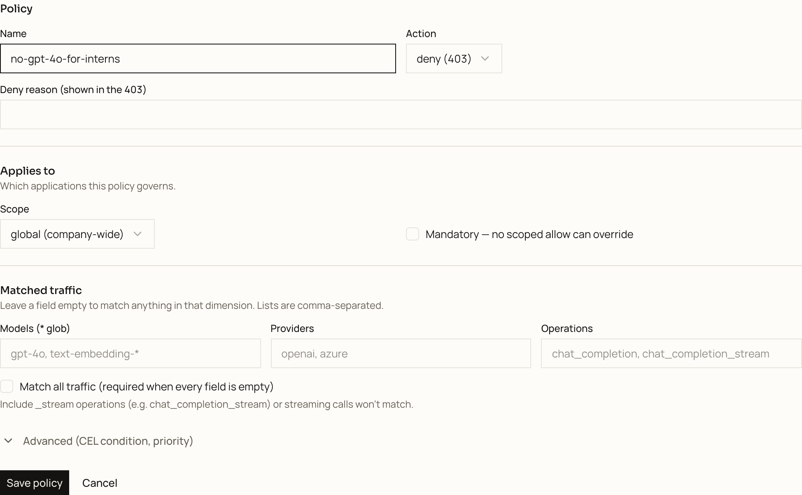

An LLM policy allows or denies calls by what they are, not by what they contain: which model, which provider, which
kind of operation. Use policies for company rules such as "no one uses `gpt-4o` for embeddings", "the interns' team
may only use small models", or "no images through the gateway".

Go to **Policies** > **LLM Policies** and select **New policy**, or **Start from a template**.

{/* SCREENSHOT: llm-policy-form | crop | New policy: Name no-gpt-4o-for-interns, Action deny (403), Deny reason, Scope global, Mandatory, Models, Providers, Operations, Match all traffic. */}

| Field | What it does |
|---|---|
| **Name** | For example `no-gpt-4o-for-interns` |
| **Action** | **deny** refuses matching calls with `403`. **allow** lets them through. **external** asks your policy decision point (below). |
| **Deny reason (shown in the 403)** | Tells the caller why |
| **Scope** | **global (company-wide)**, one **Virtual key**, or one **Team** |
| **Mandatory** | For a global policy: no narrower **allow** can override it |
| **Models (* glob)** | For example `gpt-4o, text-embedding-*` |
| **Providers** | For example `openai, azure` |
| **Operations** | For example `chat_completion, chat_completion_stream` |
| **Match all traffic** | Required when every field above is empty |
| **Advanced** | A **CEL condition** that must also hold, and a **Priority** |

Select **Save policy**.

<Warning>
Streaming calls have their own operation names. A policy on `chat_completion` does not match streamed chats unless you
also list `chat_completion_stream`.
</Warning>

## Which policy wins

1. A **mandatory** global policy always wins.
2. Then a virtual key's policies, then its team's, then global ones.
3. If no policy matches, the call is allowed.

A denied call gets `403` with `type` `llm_policy_denied` and your deny reason. It is not retried or sent to a fallback,
and it is listed in [Policy Blocks](/llm-gateway/protect/policy-blocks-and-alerts).

## Decide with your own policy engine (OPA)

For rules that need your own logic or data, use **external** policies:

- **PDP sidecar (OPA)**: switch on **Enable the policy decision point**, enter its **Base URL** (for example
  `http://127.0.0.1:8181`) and **Decision path** (`rekori/llm/decision`), a **Timeout (ms)**, and what to do **On PDP
  failure**. Select **Save**.
- **External policies (Rego)**: write Rego modules here and **Save & push** them to the sidecar, or **Load starter**
  for an example. **Sync now** pushes again.

If the policy decision point does not answer, Rekori fails closed by default: calls that needed its decision are
refused. After five failures in a row it stops asking for ten seconds.
