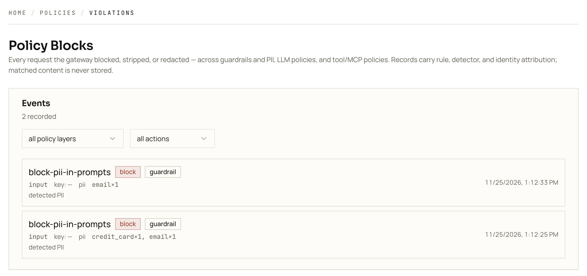
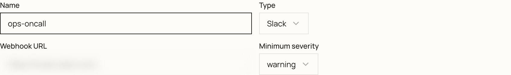

## Policy Blocks

**Policies** > **Policy Blocks** lists every call Rekori blocked, stripped or redacted, from every layer:
[content rules](/llm-gateway/protect/content-rules), [LLM policies](/llm-gateway/protect/llm-policies) and
[tool policies](/llm-gateway/protect/tool-policies).

{/* SCREENSHOT: policy-blocks | crop | Policy Blocks: 2 recorded, filters all policy layers / all actions, two block-pii-in-prompts events with input, pii, email×1 and credit_card×1. */}
<Frame caption="Policies > Policy Blocks">
  
</Frame>

Each event shows the rule, the action (**block**, **redact**, strip), the layer, where it happened (input or output),
the key, what was detected (for example `email×1`), and the time. **The blocked content itself is never stored.**

Filter with **all policy layers** and **all actions**. Events are kept for 30 days.

<Note>
A global content rule on input can block a call before Rekori has checked its key. Those events show **key: —**.
</Note>

## Alerts

Send a notice to your team when something is blocked. Go to **Alerts** > **Channels**:

{/* SCREENSHOT: alert-channel-form | crop | Add channel form: Name ops-oncall, Type Slack, Webhook URL, Minimum severity warning. */}
<Frame caption="A new channel under Alerts > Channels">
  
</Frame>

| Field | What to enter |
|---|---|
| **Name** | For example `ops-oncall` |
| **Type** | **Slack**, **Webhook** or **PagerDuty** |
| Webhook URL, or routing key | Slack's incoming webhook URL, your webhook URL, or a PagerDuty routing key |
| **Minimum severity** | **info**, **warning** or **critical**. Lower alerts are not sent to this channel. |

Select **Add channel**, then **Test** to send a test message.

<Note>
Alerts are sent for policy blocks, at most one a minute across the gateway, so a burst of blocks does not flood the
channel. Read **Policy Blocks** for the full list.
</Note>

## In metrics

Every block is also counted in Prometheus as `bifrost_policy_violations_total`, labelled by enforcement layer,
feature, action, stage, scope and rule.
