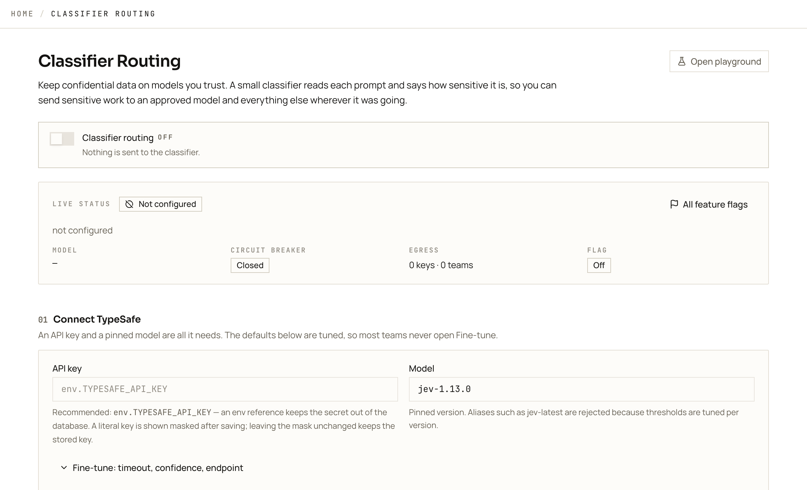
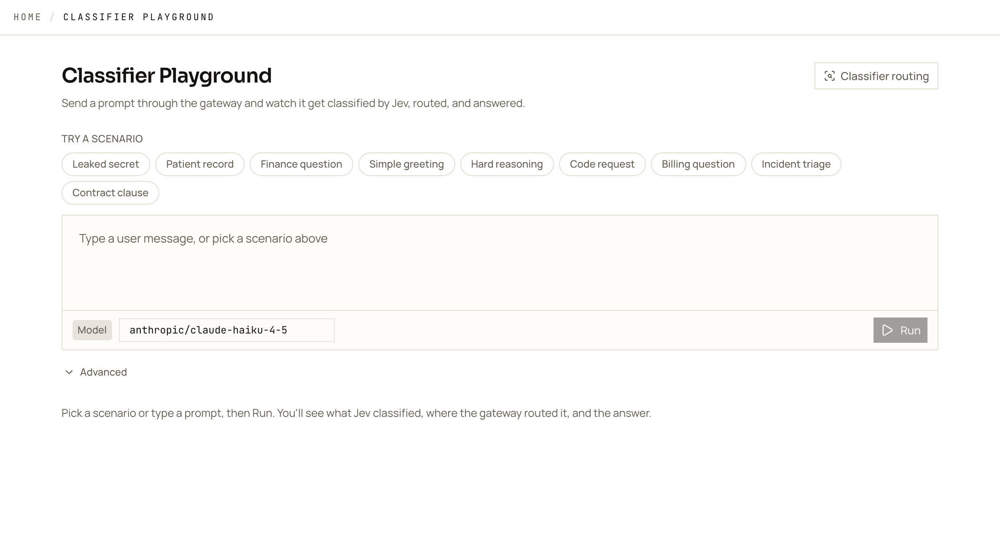

Classifier routing sends each prompt to a small hosted classifier, TypeSafe Jev, which says:

- how **sensitive** the data is: `PUBLIC`, `INTERNAL`, `CONFIDENTIAL` or `RESTRICTED`, with `PII`, `PHI`, `PCI` and
  `SECRETS` flags;
- how **complex** the task is;
- its **purpose**, from purposes you define, such as `billing_support` or `code_generation`.

Routing rules read the answers, for example to keep confidential prompts on an approved model.

<Warning>
Unlike complexity and semantic routing, this sends the prompt **outside Rekori**, to TypeSafe's API. It only happens
for the virtual keys and teams you choose, and only when a rule needs the answer.
</Warning>

{/* SCREENSHOT: classifier-config | crop | Classifier Routing: Classifier routing OFF, Live status Not configured, 01 Connect TypeSafe with API key and Model. */}
<Frame caption="Routing > Classifier Routing">
  
</Frame>

## Set it up

<Steps>
  <Step title="Connect TypeSafe">
    Under **Connect TypeSafe**, enter the **API key** (as `env.TYPESAFE_API_KEY`, so the secret stays out of the
    database) and keep the pinned **Model**. **Fine-tune** holds the timeout, confidence thresholds and endpoint.
  </Step>
  <Step title="Choose whose prompts are classified">
    Pick **Everyone**, or specific **Virtual keys** or **Teams**. Nobody else's prompts are ever sent.
  </Step>
  <Step title="Define purposes (optional)">
    Add the purposes your traffic has, each with a short description. With **Route by job automatically**, a
    purpose can route straight to its model without a rule.
  </Step>
  <Step title="Turn it on and add rules">
    Switch on **Classifier routing**. Then add [routing rules](/llm-gateway/routing/routing-rules) that read the results, for
    example **By sensitivity** > **Sensitive data**, or `jev_sensitivity == "RESTRICTED"`.
  </Step>
</Steps>

If the classifier is slow or fails, the call gets no classification and continues on its normal route; it is never
blocked by the classifier itself.

## Try it first

**Routing** > **Classifier Playground** sends a prompt through the gateway and shows what Jev classified, where the
gateway routed it, and the answer. Pick a scenario or type a message, then **Run**.

{/* SCREENSHOT: classifier-playground | crop | Classifier Playground with the scenario chips, empty prompt box, Model anthropic/claude-haiku-4-5, Run. */}
<Frame caption="Routing > Classifier Playground">
  
</Frame>

## Variables for rules

| Variable | Values |
|---|---|
| `jev_sensitivity` | `PUBLIC`, `INTERNAL`, `CONFIDENTIAL`, `RESTRICTED` |
| `jev_sensitivity_flags` | Any of `PII`, `PHI`, `PCI`, `SECRETS` |
| `jev_complexity_tier` | `SIMPLE`, `MEDIUM`, `COMPLEX`, `REASONING` |
| `jev_purpose` | One of your purposes, or `other` |
| `jev_sensitivity_confidence`, `jev_complexity_confidence`, `jev_purpose_confidence` | 0 to 1 |
