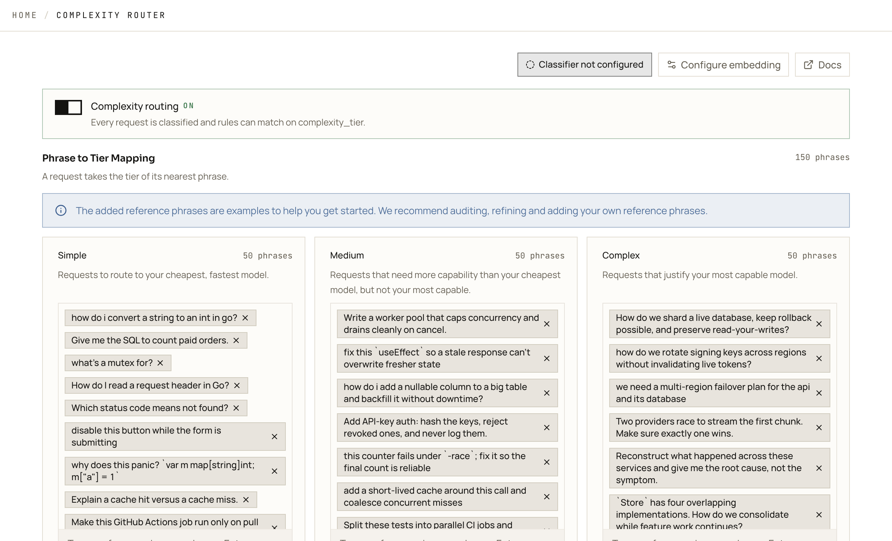

Most prompts do not need your strongest model. Complexity routing labels each request **Simple**, **Medium** or
**Complex**, and your routing rules send each tier to a model that fits.

## How it works

1. Rekori takes the latest user message.
2. It turns the message into an embedding, with an embedding model you choose.
3. It finds the nearest **reference phrase**. Each phrase belongs to a tier; the request takes that tier.
4. Routing rules read the tier as `complexity_tier`: `SIMPLE`, `MEDIUM` or `COMPLEX`.

Classification only runs when a rule uses `complexity_tier`, so requests no rule cares about cost nothing extra. When
there is no confident match, no tier is set and the call goes its normal way.

{/* SCREENSHOT: complexity-tiers | crop | Complexity Router: Complexity routing ON, Phrase to Tier Mapping with Simple, Medium, Complex columns of reference phrases. */}
<Frame caption="Routing > Complexity Router">
  
</Frame>

## Set it up

<Steps>
  <Step title="Choose the embedding model">
    Go to **Routing** > **Complexity Router** and select **Configure embedding**. Choose the **Embedding provider**
    and **Embedding model**. Until this is done, the page shows **Classifier not configured** and no tier is set.
  </Step>
  <Step title="Review the reference phrases">
    Rekori starts with 150 example phrases, 50 per tier. Add phrases from prompts your users really send, and remove
    ones that do not fit. **Restore defaults** brings back the originals.
  </Step>
  <Step title="Add rules per tier">
    In [Routing rules](/llm-gateway/routing/routing-rules), choose **By prompt difficulty** and a tier, then the model for it. For
    example: **Simple** to `openai/gpt-4o-mini`, **Complex** to `anthropic/claude-sonnet-4-5`. Start the rules in
    **shadow mode** and compare in [Routing insights](/llm-gateway/routing/routing-insights).
  </Step>
</Steps>

## Options

| Setting | What it does |
|---|---|
| **Complexity routing** | The switch on this page. On by default. |
| **Minimum similarity threshold** | Below this similarity, no tier is set. `0` accepts the nearest phrase. |
| **Embedding timeout (ms)** | How long to wait for the embedding before giving up (no tier) |
| **Session-aware routing** | In a conversation, a turn with no tier of its own reuses the tier from earlier turns |
| **Fallback classifier** | A model asked to choose the tier when embedding found no confident match |
| **Count embedding cost toward budgets**, **Count classification cost toward budgets** | Whether that extra cost counts against the caller's budget |
