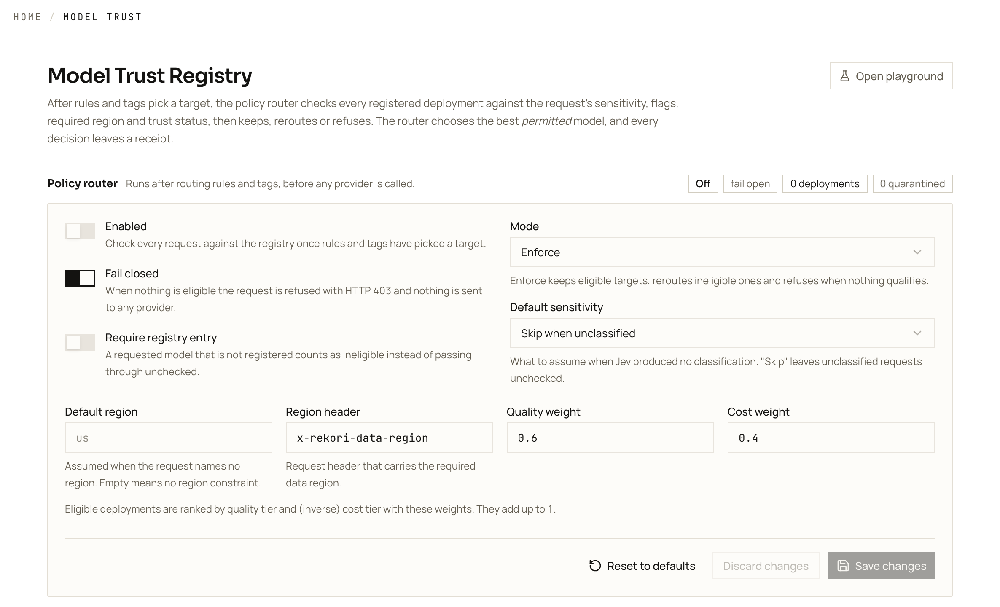

The Model Trust Registry lists your model deployments and what each may be trusted with: which classes of data,
which regions, and whether it is approved at all. After routing rules pick a target, the **policy router** checks
that target against the request's sensitivity and required region, and then:

- **keeps** the target when it is allowed,
- **reroutes** to the best allowed deployment when it is not,
- **refuses** the call (`403`) when no deployment is allowed.

A fallback can never escape to a deployment that is not allowed.

{/* SCREENSHOT: model-trust-registry | crop | Model Trust Registry: Policy router Off, fail open, 0 deployments; settings Enabled, Fail closed, Require registry entry, Mode Enforce, Default sensitivity, Default region, Region header, weights. */}
<Frame caption="Routing > Model Trust Registry">
  
</Frame>

## Register deployments

Under **Registry**, select **Register deployment** for each model you use:

| Field | What to enter |
|---|---|
| **Name** | For example `gpt-4o-us` |
| **Provider**, **Model** | Where it runs |
| **Region** | Where it processes data, for example `us` or `eu` |
| **Approved data classes** | The highest sensitivity it may see |
| **Allowed flags** | Which of `PII`, `PHI`, `PCI`, `SECRETS` it may see |
| **Trust status** | Approved, or not (a deployment can be quarantined) |
| **Hosting**, **Quality tier**, **Cost tier** | Used to rank allowed deployments when rerouting |
| **Notes (optional)** | For example the date the data agreement was signed |

## Turn on the policy router

| Setting | What it does |
|---|---|
| **Enabled** | Check every request against the registry |
| **Mode** | **Enforce** keeps, reroutes and refuses. **Advisory** only records what it would do. |
| **Fail closed** | When nothing is allowed, refuse the call. Off lets it through. |
| **Require registry entry** | A model not in the registry counts as not allowed |
| **Default sensitivity** | What to assume when a request was not classified |
| **Default region**, **Region header** | The required region when the request does not name one, and the header that names it (`x-rekori-data-region`) |
| **Quality weight**, **Cost weight** | How to rank allowed deployments when rerouting |

Sensitivity comes from [classifier routing](/llm-gateway/routing/classifier-routing), so turn that on for the keys and teams
whose data you want checked.

## Check before you enforce

- **Policy check** shows, for a sample request, which deployments are allowed and which one would be picked.
- **Simulate a change** shows how recent traffic would have gone under different settings: kept, rerouted, blocked,
  restricted data sent outside, and the cost difference.

Start in **Advisory** mode, read the results, then switch to **Enforce**.
