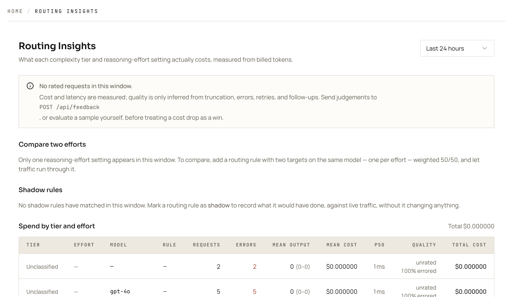

**Routing** > **Routing Insights** shows what your routing choices cost, measured from billed tokens: by complexity
tier and reasoning effort, for rules in shadow mode, and between two settings you are testing.

{/* SCREENSHOT: routing-insights | crop | Routing Insights, Last 24 hours: note on rated requests, Compare two efforts, Shadow rules, Spend by tier and effort table. */}
<Frame caption="Routing > Routing Insights">
  
</Frame>

## What it shows

| Section | Shows |
|---|---|
| **Spend by tier and effort** | For each complexity tier, reasoning effort, model and rule: requests, errors, mean output, mean cost, median latency, quality and total cost |
| **Shadow rules** | For each rule in [shadow mode](/llm-gateway/routing/routing-rules): how many calls it would have changed, and to what |
| **Compare two efforts** | Cost per request and output tokens for a **Baseline** and a **Variant** |

Choose the period at the top right: **Last hour**, **Last 24 hours**, **Last 7 days** or **Last 30 days**.

## Test a change safely

1. Create the rule with **Try it first (shadow mode)** on.
2. Let traffic run, then read **Shadow rules**: how many calls it would have moved, and the expected cost.
3. If it looks right, turn shadow mode off.

To compare two reasoning efforts on one model, add a rule with two targets on that model, one per effort, weighted
50/50, and read **Compare two efforts**.

<Note>
Cost and latency are measured. Quality is only inferred from truncation, errors, retries and follow-ups. Send your own
judgements to `POST /api/feedback`, or review a sample, before treating a cost drop as a win.
</Note>
