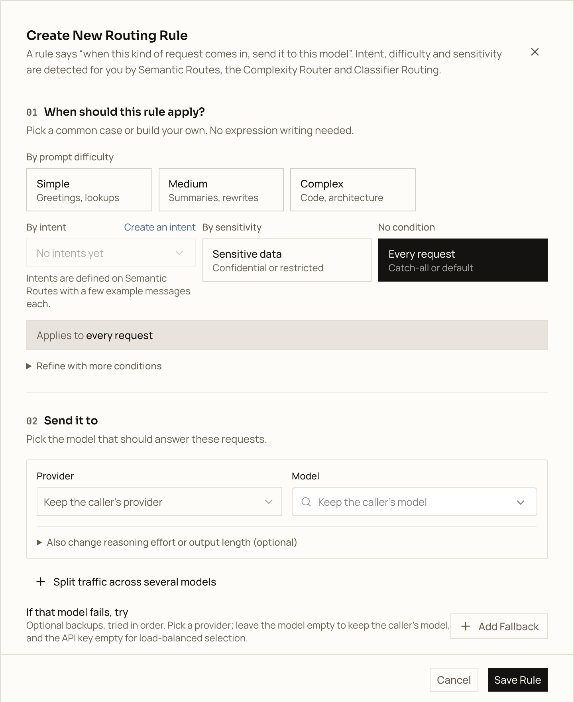
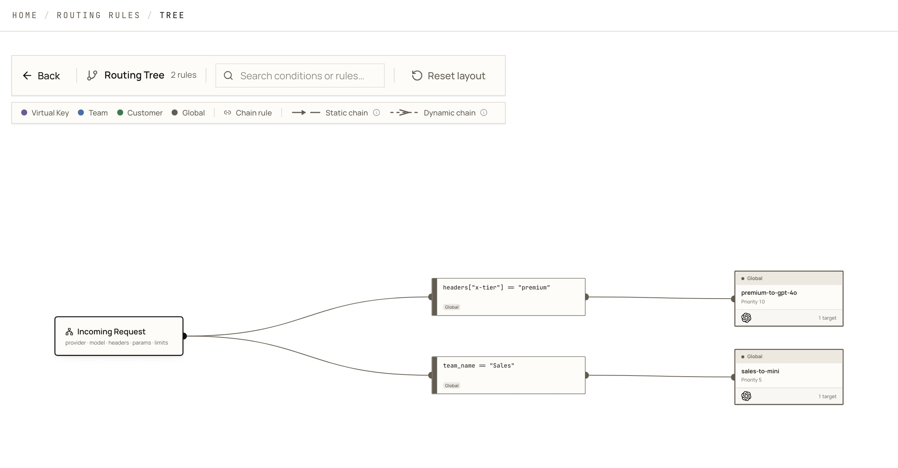
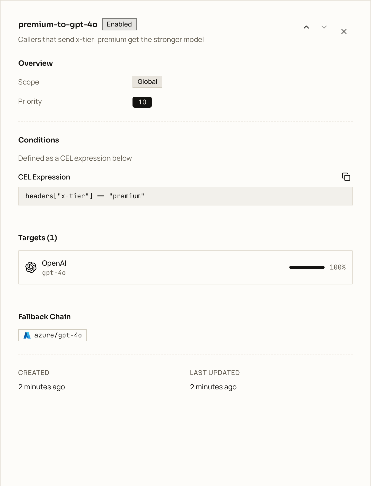

A routing rule says "when this kind of request comes in, send it to this model". Callers keep asking for the model
they always ask for; the rule decides where the call really goes. Use rules to move a team to a cheaper model, send
hard prompts to a stronger one, split traffic between two models, or add fallbacks for everyone.

## Create a rule

Go to **Routing** > **Routing Rules** and select **New Rule**.

{/* SCREENSHOT: routing-rule-form | crop | Create New Routing Rule: 01 When should this rule apply? (difficulty, intent, sensitivity, Every request), 02 Send it to (Provider, Model), If that model fails, try. */}


<Steps>
  <Step title="When should this rule apply?">
    Pick a common case: **By prompt difficulty** (**Simple**, **Medium**, **Complex**), **By intent** (a
    [semantic route](/llm-gateway/routing/semantic-routes)), **By sensitivity**, or **Every request**. **Refine with more
    conditions** narrows it further, for example to one team or one header.
  </Step>
  <Step title="Send it to">
    Choose the **Provider** and **Model**, or keep the caller's. **Also change reasoning effort or output length**
    overrides those for the call. **Split traffic across several models** adds targets with weights, for example 80% to
    one model and 20% to another.
  </Step>
  <Step title="If that model fails, try">
    **Add Fallback** for backups, tried in order. Leave the model empty to keep the caller's model.
  </Step>
  <Step title="Name it and save">
    Give it a **Rule Name**, check the options below, and select **Save Rule**.
  </Step>
</Steps>

| Option | What it does |
|---|---|
| **Enable Rule** | Off keeps the rule but never applies it |
| **Try it first (shadow mode)** | Records what the rule would have done in [Routing insights](/llm-gateway/routing/routing-insights), without changing any call. Turn this on first. |
| **Chain Rule** | After this rule matches, the rules run again with the new provider and model. Up to **Routing Chain Max Depth** times (10 by default). |
| **Scope** | Who the rule applies to: everyone (**Global**), or one customer, team, user or virtual key |
| **Priority** | Order within a scope. **Lower numbers run first.** |

## Which rule wins

Rules are checked from the narrowest scope to the widest: virtual key, user, team, customer, then global. Within a
scope, lower **Priority** first. **The first rule that matches wins**; the others are skipped, unless it is a chain rule.

## Conditions in CEL

Every condition is a CEL expression. The common cases fill it in for you; you can also write it yourself:

```cel
headers["x-tier"] == "premium"
team_name == "Sales" && model == "gpt-4o"
complexity_tier == "COMPLEX"
semantic_route == "billing-support"
budget_used > 80
```

| Variable | Holds |
|---|---|
| `model`, `provider` | What the caller asked for |
| `request_type` | `chat_completion`, `embedding`, … (`_stream` suffix for streams) |
| `headers`, `params` | Request headers and parameters, by name (lower-case) |
| `virtual_key_id`, `virtual_key_name`, `user_id`, `team_id`, `team_name`, `customer_id`, `customer_name` | Who is calling |
| `budget_used`, `tokens_used`, `request` | How much of the caller's budget and limits is used, in percent |
| `complexity_tier` | From [complexity routing](/llm-gateway/routing/complexity-router) |
| `semantic_route`, `semantic_route_score` | From [semantic routing](/llm-gateway/routing/semantic-routes) |
| `jev_sensitivity`, `jev_sensitivity_flags`, `jev_purpose`, … | From [classifier routing](/llm-gateway/routing/classifier-routing) |

## See every rule at once

**View Tree** draws all rules from an incoming request to their targets, by scope.

{/* SCREENSHOT: routing-tree | crop | Routing Tree with two rules: headers["x-tier"] == "premium" → premium-to-gpt-4o, team_name == "Sales" → sales-to-mini. */}
<Frame caption="View Tree under Routing > Routing Rules">
  
</Frame>

Select a rule in the list to see its condition, targets and fallback chain:

{/* SCREENSHOT: routing-fallback | crop | premium-to-gpt-4o details: CEL Expression, Targets OpenAI gpt-4o 100%, Fallback Chain azure/gpt-4o. */}


<Note>
A rule cannot give a caller a model its [virtual key](/llm-gateway/access-and-spend/virtual-keys) does not allow: access is
checked on where the call is going after routing.
</Note>
