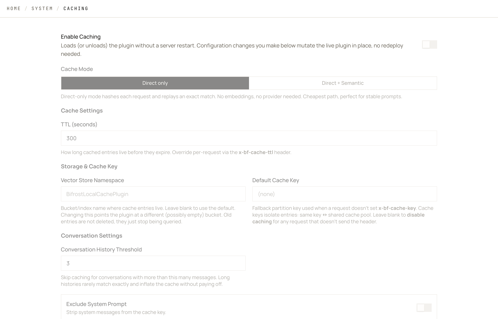

With caching on, Rekori keeps answers and gives a stored answer when the same question comes again, with no provider
call and no cost. It helps most with repeated questions: FAQ bots, fixed prompts, retries. It helps little with long
conversations or prompts that change every time.

## Turn it on

Go to **System** > **Caching** and switch on **Enable Caching**. It takes effect without a restart.

{/* SCREENSHOT: caching-settings | crop | System > Caching: Enable Caching off, Cache Mode Direct only / Direct + Semantic, TTL 300, Vector Store Namespace, Default Cache Key, Conversation History Threshold 3. */}
<Frame caption="System > Caching">
  
</Frame>

| Setting | Default | What it does |
|---|---|---|
| **Cache Mode** | **Direct only** | **Direct only** reuses an answer for the identical request. **Direct + Semantic** also reuses it for a *similar* request; it needs an embedding provider and model. |
| **TTL (seconds)** | 300 | How long an answer is kept |
| **Similarity Threshold** | 0.8 | For semantic mode: how similar a request must be, from 0 to 1 |
| **Default Cache Key** | none | Which cache a request uses when it sends no `x-bf-cache-key`. **Left empty, requests without that header are not cached.** |
| **Conversation History Threshold** | 3 | Conversations with more messages than this are not cached |
| **Exclude System Prompt** | off | Leave the system prompt out when comparing requests |
| **Cache by Model**, **Cache by Provider** | on | Keep answers separate per model and per provider |

<Warning>
With **Default Cache Key** empty, caching only applies to calls that send `x-bf-cache-key`. Set a default key to cache
everything, or send the header from the apps that should be cached.
</Warning>

## Control it per call

| Header | Effect |
|---|---|
| `x-bf-cache-key: <key>` | Use this cache. Calls with the same key share answers; different keys never do. |
| `x-bf-cache-ttl: 600` | Keep this answer for 600 seconds (or `10m`) |
| `x-bf-cache-threshold: 0.9` | Stricter similarity for this call |
| `x-bf-cache-type: direct` | Only an identical match for this call |
| `x-bf-cache-no-store: true` | Use the cache, but do not store this answer |

A cached answer is logged like any other call, marked as a cache hit, with no provider cost.

## Where similar-match data is kept

Semantic mode stores embeddings in a vector store, set in the gateway's configuration (`vector_store`): built in
(chromem), Redis or Valkey, Qdrant, Weaviate or Pinecone.

<Note>
The built-in store keeps entries on each Rekori node. With several nodes, use a shared store such as Redis so they
share answers.
</Note>
