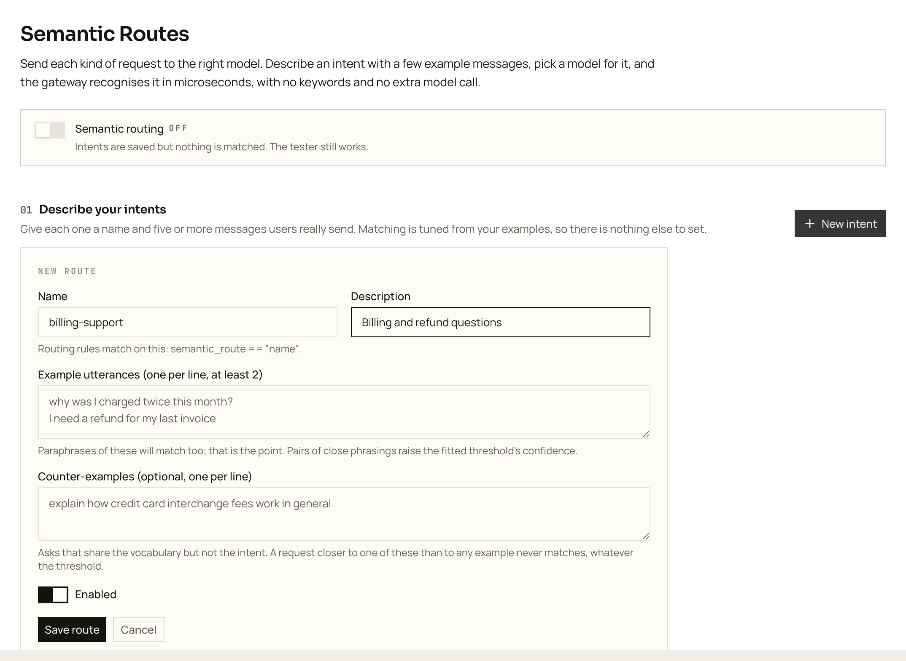

A semantic route is a named intent, such as `billing-support` or `sql-help`, described by a few example messages.
Rekori compares each request's latest user message with your examples and tells routing rules which intent it
matched. Matching runs inside Rekori in microseconds, with no extra model call and nothing sent out.

## Create an intent

Go to **Routing** > **Semantic Routes** and select **New intent**:

| Field | What to enter |
|---|---|
| **Name** | The name rules match on, for example `billing-support` |
| **Description** | What the intent covers |
| **Example utterances (one per line, at least 2)** | Messages users really send for this intent. Five or more works best. |
| **Counter-examples (optional, one per line)** | Messages that use the same words but mean something else. A request closer to one of these never matches. |
| **Enabled** | Off keeps the intent but never matches it |

Select **Save route**.

{/* SCREENSHOT: semantic-route-form | crop | Semantic Routes: Semantic routing OFF, New route form for billing-support with example utterances and counter-examples. */}
<Frame caption="A new intent under Routing > Semantic Routes">
  
</Frame>

Use **Try a message** on the same page to see which intent a message matches, and how closely, before you rely on
it.

## Turn it on and route

1. Switch on **Semantic routing** at the top of the page. It is **off** by default; with it off, intents are saved
   but nothing is matched.
2. In [Routing rules](/llm-gateway/routing/routing-rules), choose **By intent**, or write `semantic_route == "billing-support"`.

Rules read two variables: `semantic_route` (the matched intent's name, or empty) and `semantic_route_score` (how
close the match was).

<Note>
Matching uses a small English-language model built into Rekori. Messages in other languages match less reliably.
</Note>
