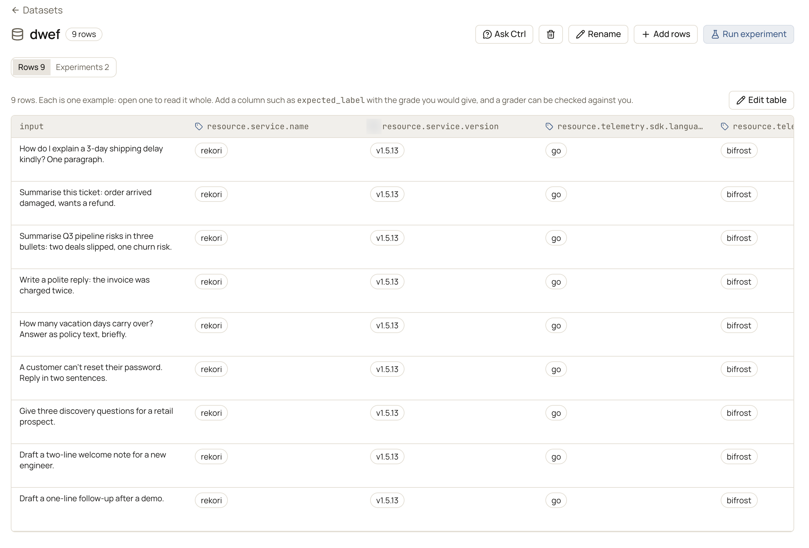

<Note>You need a model connection for prompts and model judges, and a trace store connection to capture rows from traces or grade your agent's latest answers (see [Connect trace stores and models](/monitor/evals/get-started#connect-trace-stores-and-models)). You also need at least one saved [evaluator](/monitor/evals/evaluators), and the **Operator** role or above.</Note>

A dataset is a test set in **Monitor** > **Evals** > **Datasets**. Each row is one example: what was asked, what the agent had to go on, what it answered and, if you like, the grade you would give it. An experiment answers and grades every row, and can compare the result with an earlier run.

## Add rows

Select **Add rows** on a dataset, then one of:

- **Import a CSV or JSON file**: paste a table from a spreadsheet, or choose a `.csv`, `.tsv`, `.json` or `.jsonl` file. The first row names the columns. A column named `expected` is each row's expected answer.

  ```csv
  input,context,output,expected_label
  "When does the plan renew?","Plans renew on the 1st.","On the 1st of each month.",grounded
  ```

- **Capture from traces**: a uniform sample of 1 to 1,000 records from the last 24 hours, 7 days or 30 days becomes rows. Each item is **One step**, a **Whole run** or a **Conversation**. A record already in the dataset is not added again, and **One item per question** captures a question asked many times once. **Seed expected answers from the recorded answers** fills them in for you to review and correct.
- **Write a row**: fill in **Expected answer (optional)** for graders that compare with one.

{/* SCREENSHOT: evals-dataset | crop | The "support-bot golden set" dataset page, 48 rows: header buttons, the Rows / Experiments switch, and the first rows. */}
<Frame caption="A dataset's rows">
  
</Frame>

## Dataset versions

Versions let you repeat an experiment on the same rows, even after the dataset changes. Every change to a dataset's rows makes a new version: adding, capturing, editing or deleting a row, or setting an expected answer. Renaming the dataset does not. A new dataset starts at v1. The **Version** column in **Datasets**, and the badge beside a dataset's name, show its latest version.

An experiment keeps the version it ran on. Changes made to the rows later never reach it: its page shows the rows as that version left them.

To read an earlier version, choose it in the list beside the dataset's name, for example **v2**. The page then says **Viewing v2, as it was. It can't be changed: edits go to the latest version, v3.** You cannot add rows or run an experiment on an earlier version. Select **View the latest** to go back.

{/* SCREENSHOT: evals-dataset-version | crop | The "support-bot golden set" dataset page showing an earlier version: the version list beside the name set to v2, and the bar "Viewing v2, as it was. It can't be changed: edits go to the latest version, v3." with View the latest. Crop to the header and the bar. */}

## Write and version a prompt

A prompt, in **Evals** > **Prompts**, is what you tell a model, with blanks such as `{input}` and `{context}`. Each blank is filled from the row's column of the same name, or one you choose. **Longest answer, in tokens** under **Advanced** starts at 1,024.

**Try it** runs the prompt as written, saved or not, on the first 5 rows of a dataset or on words typed in. Nothing is kept.

{/* SCREENSHOT: evals-prompt | later | Not taken: preview has no prompts. */}

The first save is v1, and each later change is saved as a new version (**Save as v2**, and so on). Write what changed, so the version history reads as a story.

## Run an experiment

Select **Run experiment** on a dataset, or **Use in an experiment** on a prompt. The answers come from:

- **Saved answers**: the answers already in the dataset.
- **A prompt**: a model writes a fresh answer for each row, from the version you choose (**Latest** to start).
- **Your agent's latest answers**: what your agent answered the same question lately, read from a trace store.

With **Your agent's latest answers**, OpenController finds the agent from the project's traces, and the dialog names it after **Agent:**, for example `support-bot`. You do not pick it. The experiment keeps the agent and its version with the results. When the traces name no agent, or come from several agents, no agent is kept. To name one, link the trace project to its agent: see [Make a project](/monitor/guide-trace-an-agent#step-1-make-a-project). Experiments on saved answers or a prompt name no agent.

Each evaluator you switch on grades every row. With saved answers, **Your labels** picks the column with your grades, to show how often the grader agrees with you. **Advanced: pass rules** sets a rule per evaluator, such as **Pass if score is at least** 0.8. The scorecards appear when every row is graded.

When you choose **Compare with** an earlier run, a score badge shows how many rows got worse (▾) or better (▴) than that run. To test the next version, select **Compare a new version** on a finished experiment: it keeps the same answer source and compares with this run.

An experiment compared with an earlier run grades the rows that run graded, so both scores cover the same rows. When the dataset has changed since, choose which rows to grade:

- **Grade the rows the baseline graded (dataset v2)**, the default.
- **Grade the rows as they are now (dataset v3)**.

## Read an experiment's results

An experiment's page names what it tested:

- **Agent**: the agent it evaluated, and the version its platform reported, for example **support-bot version 4**. When the platform reports no version, it says **its platform reported no version**. With no agent, it says **none named**.
- **Rows**: how many rows were answered, and the dataset version they came from, for example **48 of dataset v3**.

The agent's version is the one its platform reported at the last discovery [scan](/discover/scans). Some platforms report none.

A dataset's **Experiments** list shows the same in its **Agent** and **Rows** columns. An experiment run before datasets had versions shows **before dataset versions** on its page, and **—** under **Rows**: it graded the rows as they were while it ran.

### See every evaluation of an agent

Every experiment that evaluated an agent is also on the agent's page in [AI Inventory](/discover/asset-details), on the **Evaluations** tab. Each row gives the **Agent version** and the **Dataset** version it ran on, its **Scores**, and whether its **Pass rule** held (**Held** or **Not held**). **not reported** means the platform reported no version. The tab shows on an agent's page while the **Evals** module is on.

{/* SCREENSHOT: agent-evaluations | crop | The Evaluations tab of support-bot's page: three experiments with Agent version 3 and 4, Dataset "support-bot golden set v2" and "v3", score badges, and Held / Not held. Crop to the tab. */}

## Next steps

<CardGroup cols={2}>
  <Card title="Score answers with evaluators" icon="scale" href="/monitor/evals/evaluators">
    Test a grader on the dataset's rows.
  </Card>
  <Card title="Watch production with monitors" icon="radar" href="/monitor/evals/monitors">
    Keep watching once the new version ships.
  </Card>
</CardGroup>
