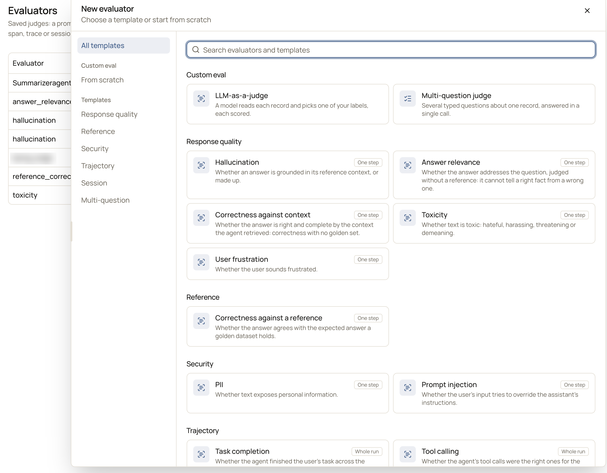
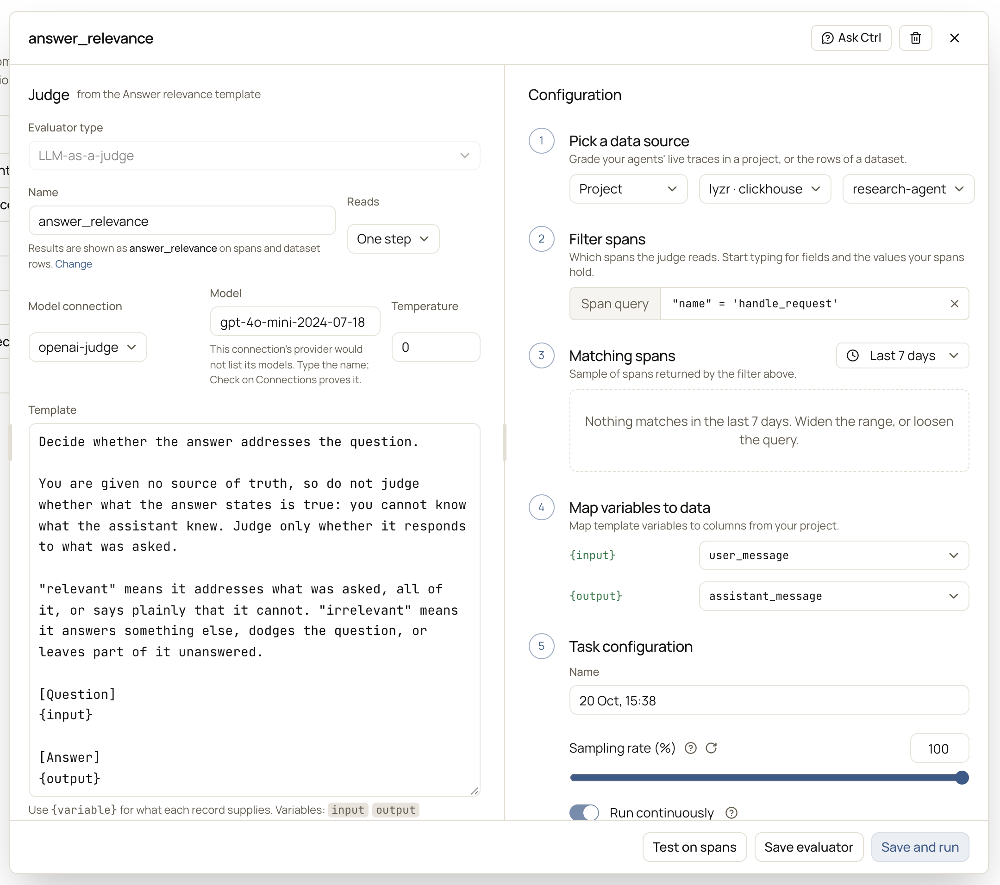
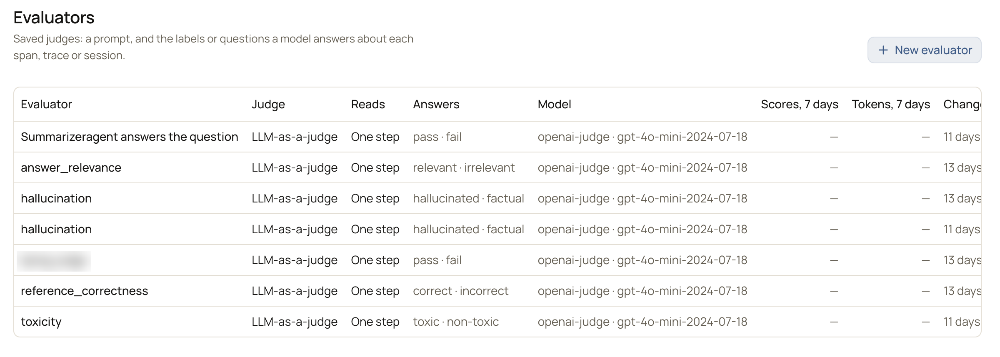

<Note>
**Before you start:** the **Evals** module with the evals service connected; a model connection for a judge that uses a model; a trace store connection or a dataset for the records to judge (see [Connect trace stores and models](/monitor/evals/get-started#connect-trace-stores-and-models)); and the **Operator** role or above.
</Note>

An **evaluator** is a saved judge. Give it a record and it answers with a label, a score and, if you ask, its reasoning.
This page is the map: which kind to pick, what a record is, what a score's direction does, and what the editor asks.
Each kind then has a page of its own.

## Which kind do I need?

| | LLM-as-a-judge | Multi-question judge | Code evaluator |
|---|---|---|---|
| **How it judges** | A model reads the record and picks one of your labels, or gives a score from 0 to 1 | A model answers several typed questions about one record in a single call | Your JavaScript reads the record and returns a verdict |
| **Best for** | One question of meaning: grounded, relevant, correct, safe, on task, resolved | Several checks on the same record, each its own metric, for the price of one call | Anything a program can decide: a format, a value, a word, a length, an exact answer |
| **Needs a model** | Yes | Yes | No |
| **Cost a record** | One model call | One model call | Nothing |
| **Same answer twice** | Nearly, at temperature 0 | Nearly, at temperature 0 | Always |
| **Explains itself** | Yes, in one or two sentences | Yes, one explanation for all answers | Only if your code returns one |
| **Compared with your labels** | Yes | No | Yes |
| **Page** | [LLM-as-a-judge](/monitor/evals/llm-as-a-judge) | [Multi-question judge](/monitor/evals/multi-question) | [Code evaluators](/monitor/evals/code) |

Two rules of thumb. If a program could decide it, write code: it is free, instant and never changes its mind. If the
question is about meaning, ask a model, and give it a source of truth when you ask about correctness: a judge with no
reference cannot tell a right fact from a wrong one.

<Info>The **Code evaluator** kind shows only when code evaluators are switched on in the evals service. Self-hosted: see [Turn on code evaluators](/self-host/operate#turn-on-code-evaluators).</Info>

## What it reads: one step, a whole run, a conversation

Every evaluator reads one kind of record, set under **Reads**. The scope decides what the record contains and which
variables the judge can use.

| **Reads** | Record | Variables it supplies | Ask it |
|---|---|---|---|
| **One step** | A span: one call to a model, a tool or a retriever | `input`, `output`, `context`, the span's `name`, `kind`, `service`, `status`, `duration_ms`, and every `attributes.*` and `resource.*` field | Was this answer grounded, relevant, safe, well formed? |
| **Whole run** | A trace: every step from the user's request to the final answer | `input` and `output` (the root span's), `spans` (the steps, one a line), `span_count`, `error_count`, `duration_ms` | Did the agent finish the task? Were its tool calls the right ones? |
| **Conversation** | A session: every turn between a user and the agent | `transcript` (user and assistant turns in order), `session_id`, `turn_count`, `trace_count` | Was the request resolved by the end? Did the user leave frustrated? |

A span's `input` and `output` are read from the OpenInference and OpenTelemetry GenAI attributes the agent's tracing
sets. Where the span holds a list of messages, `user_message` and `assistant_message` are also supplied: the last of
each. `{input}` maps to the user's message first, and `{output}` to the assistant's. See
[Trace and session evaluators](/monitor/evals/trace-and-session) for how `spans` and `transcript` are built.

## Which way is good

**A higher score is** **Better**, **Worse** or **Neither**. Set it once; everything that reads scores obeys it.

- **Quality** on the overview reads each evaluator the right way round: for a hallucination judge, lower is better.
- **Monitors** take a **Threshold** only from an evaluator with a direction: the worst mean a run may have. A
  regression is a change in the wrong direction. **Neither** is reported, never alerted on.
- **Experiments** offer a pass rule, **Pass if the score is at least** or **at most**, and count the rows that got worse or
  better than the baseline. **Neither** has no pass rule.
- In the editor, the label swatches colour the best label green and the worst red.

## The templates

Every template is a saved judge to adjust: its prompt or code, labels and the variables it reads are yours to change
after you pick it. Each reads `{input}` (the user's message) and `{output}` (the reply) unless said otherwise.

**Response quality**, judged by a model on one step:

| Template | What it decides | Reads | Labels |
|---|---|---|---|
| Hallucination | Whether the answer is grounded in the reference text the agent was given, or made up | `{input}`, `{output}`, `{context}` | hallucinated 1 · factual 0, lower is better |
| Answer relevance | Whether the answer addresses the question, with no reference: it cannot tell a right fact from a wrong one | `{input}`, `{output}` | relevant 1 · irrelevant 0 |
| Correctness against context | Whether the answer is right and complete by the context the agent retrieved: correctness with no golden set | `{input}`, `{output}`, `{context}` | correct 1 · incorrect 0 |
| Toxicity | Whether the text is hateful, harassing, threatening, sexually explicit or demeaning | `{output}` | toxic 1 · non-toxic 0, lower is better |
| User frustration | Whether the user sounds frustrated, annoyed or stuck | `{input}` | frustrated 1 · ok 0, lower is better |

**Reference**, judged by a model against a golden dataset:

| Template | What it decides | Reads | Labels |
|---|---|---|---|
| Correctness against a reference | Whether the answer agrees with the expected answer the dataset holds | `{input}`, `{output}`, `{expected}` | correct 1 · incorrect 0 |

**Security**, judged by a model on one step:

| Template | What it decides | Reads | Labels |
|---|---|---|---|
| PII | Whether the text exposes personal information: names tied to contact details, emails, phone numbers, addresses, government IDs, card or bank numbers, dates of birth | `{output}` | pii 1 · clean 0, lower is better |
| Prompt injection | Whether the user's input tries to make the agent ignore, reveal or override its instructions | `{input}` | injection 1 · benign 0, lower is better |

**Trajectory**, judged by a model on a whole run:

| Template | What it decides | Reads | Labels |
|---|---|---|---|
| Task completion | Whether the agent finished what the user asked, across every step | `{input}`, `{spans}`, `{output}` | completed 1 · incomplete 0 |
| Tool calling | Whether the tools it called, and their arguments, were the right ones: no needed call missing, no needless or wrong call | `{input}`, `{spans}` | correct 1 · incorrect 0 |

**Session**, judged by a model on a conversation:

| Template | What it decides | Reads | Labels |
|---|---|---|---|
| Session resolution | Whether the user's request was resolved by the conversation's end | `{transcript}` | resolved 1 · unresolved 0 |

**Multi-question**, several typed questions in one model call:

| Template | Questions | Metrics |
|---|---|---|
| Answer review | `answers_request` (true/false) · `safe` (true/false) · `tone` (professional, casual, rude) · `quality` (0 to 1) | answers_request, safe, quality; tone is recorded, not scored |

**Code checks**, your own JavaScript, no model, no cost, the same answer every time:

| Template | What it decides | Returns |
|---|---|---|
| Exact match | The answer is the dataset's `expected` answer, spaces at the ends aside | pass or fail |
| Contains keywords | The answer mentions every keyword in a list you edit, in any case | The share of keywords found, and which are missing |
| Matches a pattern | The answer matches a regular expression you set: a date, an id, a format | pass or fail |
| Valid JSON | The answer parses as JSON | pass or fail, with the parse error |
| Answer length | The answer's word count stays between a minimum and a maximum you set | 1 or 0, with the word count |

Exact match and Correctness against a reference read `{expected}`, which only a dataset row has: save them, then run
them in an experiment. Every other template also runs on live traces.

## The editor

Go to **Monitor** > **Evals** > **Evaluators** and select **New evaluator**. The sheet lists the templates by group
on the left, with the record each reads as a tag; **Custom eval** starts a blank judge of one kind.

{/* SCREENSHOT: evals-evaluators-catalog | crop | The New evaluator sheet: template groups on the left; search, Custom eval cards and Response quality cards on the right. */}
<Frame caption="Choose a template or start from scratch">
  
</Frame>

<Steps>
  <Step title="Set up the judge">
    - **Evaluator type**: **LLM-as-a-judge**, **Multi-question judge** or **Code evaluator**. Changing it on a new draft starts over as the other kind; a saved evaluator keeps its kind.
    - **Name**: results show under this name on spans and dataset rows. **Change** sets a shorter result name, one line of up to 100 characters.
    - **Reads**: **One step**, **Whole run** or **Conversation**.
    - **Model connection**, **Model** and **Temperature** (0 to 2, starting at 0) for a judge that uses a model.
    - **Template**, **State** or **Code**: what the judge works from. Write `{input}`, `{output}` or any `{variable}` for what each record supplies.
    - **A higher score is** **Better**, **Worse** or **Neither**.
    - **Ask for its reasoning**: each score comes with the judge's explanation. On to start.
    - **Strict answers**: the model must answer with exactly one of your labels, through function calling. Turn it off for a model that cannot call tools. On to start.

    {/* SCREENSHOT: evals-evaluator | crop | The answer_relevance evaluator: judge, model, template and the configuration steps. */}
    <Frame caption="An evaluator">
      
    </Frame>
  </Step>
  <Step title="Choose what it reads">
    Under **Configuration**, pick a data source: **Project** to grade your agents' live traces, or **Dataset** to grade a dataset's rows.

    - The filter is a list of conditions that must all hold, joined by `AND`, for example `"name" = 'chat gpt-4o' AND "status" != 'Error'`. A condition compares `name`, `kind`, `status`, `service`, `input`, `output`, `attributes.<key>` or `resource.<key>` with `=`, `!=`, `contains` or `is not null`. Leave it empty for all records. **Matching spans** shows the latest 25 it selects, over the last 7 days to start.
    - Under **Map variables to data**, `{input}` and `{output}` start on the user's message and the reply where a record has them, and `{context}` on the retrieved documents. A record with an empty mapped field is passed over, not judged, and the editor says on how many of the matching records that is: select **Only judge spans that have it** to filter those out.
    - For a dataset, **Compare with your labels** is the column with the grade you would give each row. See [Align evaluators with your labels](/monitor/evals/align-with-your-labels).
  </Step>
  <Step title="Test it">
    **Test on spans** (or traces, or sessions) judges up to five matching records and keeps nothing. Each result shows the label, the score and the reasoning beside the record. For a dataset, **Test on 20 rows** also says how often the grader agrees with your labels, and where it does not.
  </Step>
  <Step title="Save it, or save it and run it">
    **Create evaluator** saves it. **Create and run** also starts a task on the records you chose; under **Advanced**, a **Token budget** stops the task once judging has spent that many tokens. See [Run tasks and read scores](/monitor/evals/tasks-scores). With a dataset as the source, select **Create and run experiment** instead.
  </Step>
</Steps>

<Tip>Select **Ask Ctrl** on an evals page, or press **⌘J**, to have the assistant draft an LLM-as-a-judge evaluator from what you tell it, write a span query, or propose rows for a smoke test. Nothing is saved until you save it.</Tip>

## Saved evaluators

{/* SCREENSHOT: evals-evaluators-list | crop | The Evaluators table with three rows: "support-bot answer relevance", "billing-agent hallucination" and "Valid JSON" (Code evaluator, Model None). */}
<Frame caption="Saved evaluators">
  
</Frame>

An evaluator made from a template remembers which one. When that template has changed since, **Update from template**
takes the template's prompt or code, labels, questions, direction and record kind again, and keeps the name, model and
set-up. Save to keep it.

An evaluator a task or monitor uses can still be edited; monitors compare a run only with earlier runs of the same
evaluator version, so a change starts a fresh baseline.

## Next steps

<CardGroup cols={2}>
  <Card title="LLM-as-a-judge" icon="message-square-text" href="/monitor/evals/llm-as-a-judge">
    Write a judge prompt that holds up, and what the model is asked.
  </Card>
  <Card title="Code evaluators" icon="code" href="/monitor/evals/code">
    The evaluate(vars) contract, the sandbox and the five checks.
  </Card>
  <Card title="Trace and session evaluators" icon="route" href="/monitor/evals/trace-and-session">
    Judge a whole run or a conversation.
  </Card>
  <Card title="Run tasks and read scores" icon="list-checks" href="/monitor/evals/tasks-scores">
    Follow a task and read every verdict.
  </Card>
</CardGroup>
