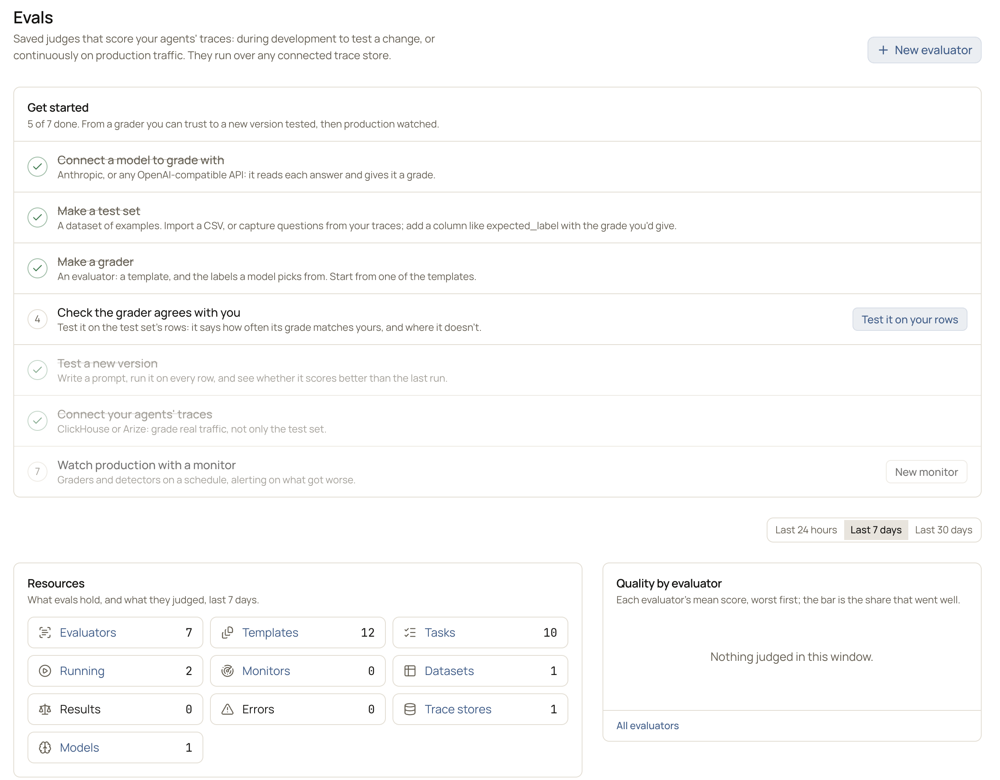
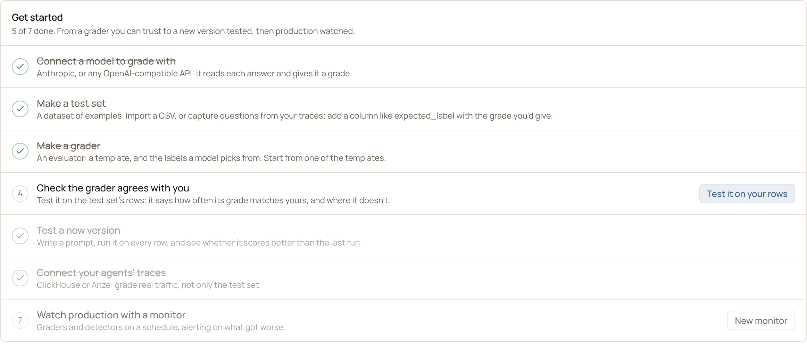

<Note>Needs the **Evals** module and a connected evals service. See [Modules](/administer/modules).</Note>

Evaluators run over any connected trace store, and over test sets you build. Evals run in their own service: until an Admin selects **Connect the evals service** and sets where it runs in **Settings** > **Evals**, the page says **No evals service connected**.

{/* SCREENSHOT: evals-overview | full | Monitor > Evals > Overview, Window Last 7 days: Get started 5 of 7 done, Resources counts, Quality by evaluator, the four metrics and the top of Latest verdicts. */}
<Frame caption="The Evals overview, last 7 days">
  
</Frame>

The words, and the loop they make, are in [What are evals?](/monitor/evals/what-are-evals).

Judging with a model costs money: each record judged is one model call, and **Judge tokens** shows what judging spent. Code evaluators use no model and cost nothing.

<Tip>Select **Ask Ctrl** on an evals page, or press **⌘J**, to have the assistant write a grader, draft dataset rows, or explain the page.</Tip>

## Get started

Until every step is done, **Overview** shows **Get started**: the way from a grader you can trust, to a new version tested, to production watched. The test set needs a column like `expected_label` for the grade you'd give, so you can check the grader agrees with you.

{/* SCREENSHOT: evals-get-started | crop | The Get started panel alone, "3 of 7 done", step 4 "Check the grader agrees with you" with its primary button "Test it on your rows". */}
<Frame caption="Get started, three steps done">
  
</Frame>

**Quality by evaluator** and **Quality** read each score by its evaluator's direction: for a hallucination judge, lower is better. **Error rate** is the share that could not be judged.

## Connect trace stores and models

Evaluators read records from a trace store (**ClickHouse** or **Arize**) and judge them with a model (**Anthropic**, or **OpenAI-compatible (Rekori, OpenAI, …)**). Add both in **Evals** > **Connections**.

- **ClickHouse**: the address of its HTTP interface (port 8123), and a user that can only read. Leave **Database** and **Traces table** empty for `otel` and `otel_traces`, the collector's defaults.
- **Arize**: the **Space ID** your projects are in.
- **Model**: for **OpenAI-compatible (Rekori, OpenAI, …)**, the API's address up to `/v1`, the one `/chat/completions` hangs from; **Anthropic** fills in its own. To judge through the LLM gateway, use the OpenAI-compatible kind with the gateway's address and a virtual key.
- **Arize** has a rate limit of ten calls a minute, so a large window is read in pages; ClickHouse has none.

The **Password** or **API key** is sealed in the evals service and never shown again.

**Save** saves the connection and checks it: a trace store is asked for one row, a model is asked for its models and, when an evaluator names one, for a real answer. Changing a connection's address, kind or user asks for its secret again. If the check fails, it stays saved and the dialog says **Saved, but it does not work yet:** with the reason. A model connection is checked with a real answer from a model an evaluator uses. A connection an evaluator, task or monitor uses cannot be removed.

## Who can use it

- **Viewer** reads every evals page. What agents were asked and answered is hidden; scores, labels and counts show.
- **Operator** also reads what was asked and answered, and makes, tests, runs and deletes evaluators, tasks, monitors, datasets, prompts and experiments.
- **Admin** and **Owner** also add, change, check and remove connections, and set where the evals service runs.

## Next steps

<CardGroup cols={2}>
  <Card title="Choose and build an evaluator" icon="scale" href="/monitor/evals/evaluators">
    Start from a template and test it on real traces.
  </Card>
  <Card title="Run tasks and read scores" icon="list-checks" href="/monitor/evals/tasks-scores">
    Judge a window of traffic, or every new record.
  </Card>
</CardGroup>
