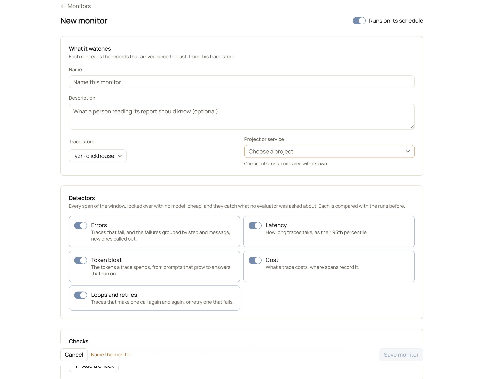

<Note>
**Before you start:** a trace store connection (see [Connect trace stores and models](/monitor/evals/get-started#connect-trace-stores-and-models)); for checks, at least one saved [evaluator](/monitor/evals/evaluators) (detectors need none); for alerts, a Slack or Microsoft Teams incoming webhook, or any webhook address; and the **Operator** role or above.
</Note>

A task tells you what each record scored. A **monitor** tells you what changed. On a schedule it reads the traffic
since its last run, judges a sample with the evaluators you chose, runs five detectors over every span with no model
at all, compares every figure with the runs before, and sends an alert when one got worse.

Go to **Monitor** > **Evals** > **Monitors** and select **New monitor**. Turn off **Runs on its schedule** to save it
**Paused**; **Run now** works either way.

## What it watches

Pick one **Project or service**, so an agent's runs are compared with its own. Each run reads the records that
arrived since the last run, up to **Look back, hours** back, and stops a minute short of now so late spans are not
missed. A run that finds nothing wrong moves the mark forward; one that fails to complete leaves it, so the next run
covers the gap.

## Detectors

**Detectors** look over every span of the window, reading only its metadata: no model, no cost, and they catch what no
evaluator was asked about. All five are on to start.

| Detector | Measures, per trace | Finding |
|---|---|---|
| **Errors** | Whether any span's status says error. Failures are grouped by step and message, with ids and numbers masked, so the same fault is one group | A group no earlier run saw is a **new failure**. With no runs to compare, a tenth or more of traces failing is a warning |
| **Latency** | The longest span's duration, summed up as the 95th percentile | A rise of a fifth or more, beyond chance, is a regression |
| **Token bloat** | The tokens a trace spends, from the spans' GenAI usage attributes: prompts that grow, answers that run on | A rise of a fifth or more is a regression; a fall is noted |
| **Cost** | What a trace costs, where spans record it | As token bloat |
| **Loops and retries** | A trace's most repeated call, the same step with the same input, or retries after a failure | Three or more is a loop; ten or more is a **runaway**, warned on at once |

Each finding comes with up to three example traces as evidence, and the groups are capped at ten.

## Checks

**Checks** are the evaluators each run judges a sample with. Each evaluator can be in one check. **Only records where**
starts from the evaluator's own filter. Records without a mapped variable are passed over, and counted.

- **Records per check** is a uniform sample of the window, 10 to 1,000, starting at 100. A monitor reads at most 20,000
  records to draw it.
- A **Threshold** is the worst mean a run may have: the least, when higher is better; the most, when lower is better.
  Past it, beyond chance, the finding is critical; past it on too few scores to be sure, it is noted as possibly chance.
- An evaluator whose higher score is **Neither** better nor worse is reported, never alerted on, and takes no threshold.
- A multi-question judge gives one check per scored question, each with its own trend and threshold.

{/* SCREENSHOT: evals-monitor | crop | The New monitor page from "Detectors" to "Schedule": five detectors on, one check card with Variables and a Threshold of 0.8, Schedule Daily at 09:00, Time zone Europe/London. */}
<Frame caption="Detectors, a check and the schedule of a new monitor">
  
</Frame>

## Schedule and judging

A new monitor runs **Daily** at 09:00 in your browser's time zone. The presets are **Hourly**, **Every 6 hours**,
**Daily**, **Weekdays**, **Weekly** and **Cron**: minute, hour, day of month, month, day of week, for example
`30 8 * * 1-5`. A monitor runs at most every five minutes, and starts up to two minutes after its time so many monitors
do not hit the store together.

| **Judging** field | What it does | Range | Starts at |
|---|---|---|---|
| **Records per check** | A uniform sample of the window | 10 to 1,000 | 100 |
| **Look back, hours** | The longest window a run reads | 1 to 720 | 24 |
| **Baseline, runs** | Earlier runs a score is compared with | 1 to 30 | 7 |
| **Tolerance** | The least change in a mean that counts | 0.01 to 1 | 0.05 |

## How a change is judged real

A difference between this run and the baseline is reported only when all of these hold:

- It is at least the **Tolerance**; for latency, tokens and cost, a rise of at least a fifth.
- It is significant at 5% by a two-sample test, with the 5% shared across every test the run makes, so a monitor with
  many checks does not cry wolf by volume.
- Each mean rests on at least ten scores.

The **Baseline** pools up to that many earlier runs of the same evaluator version. A run that regressed ends the pool
and passes its own baseline on, so a regression stays reported until the figure recovers, rather than becoming the new
normal. Changing an evaluator starts a fresh baseline.

## Findings and severity

| Severity | When |
|---|---|
| **Critical** | A check could not run, or a threshold was crossed beyond chance |
| **Warning** | A regression against the baseline, a new failure group, a runaway loop, or a tenth or more of the sample the judge could not score (half or more is critical) |
| **Info** | An improvement, a recovery, a threshold crossed on too few scores to be sure, a window with no data |

Findings the same traces show are folded into one incident, with the traces as evidence: a new failure that also
raised latency and errors is one finding with two related ones under it, not three alarms.

## Alerts

A run's findings go to the **Webhook** when the worst of them is at or above **Alert at**: **Critical only**,
**Warnings and worse** (the default) or **Every finding**. The request is JSON with a `text` summary, the monitor's id
and name, and the run's findings; Slack and Teams incoming webhooks show the text as it is:

```text
support-bot daily: 1 critical, 2 warning, 0 info
• hallucination: mean 0.21 crossed the threshold 0.10 (critical)
• Errors: a new failure in step "lookup order": timeout after #s
  ◦ Latency: p95 rose from 2.1 s to 4.8 s
```

Alerts carry findings and figures, never trace content. The address must be `https`, with no credentials in it, and
not a private or link-local address unless the service is set to allow them (self-hosted: `EVALS_WEBHOOK_HTTP` and
`EVALS_WEBHOOK_PRIVATE`). Delivery is tried three times; a failure is kept on the run. Use **Send a test alert** to see
one arrive.

## Read its report

Select **Save monitor**, then **Run now** to run it at once.

- Each run's report lists its findings, worst first, with the examples behind each.
- From the second run on, the figures at the top show each check's and detector's trend across the runs.
- Deleting a monitor removes its schedule and run reports; the scores it judged stay in **Scores**.

{/* SCREENSHOT: evals-monitor-report | later | Not taken: no monitor has run on preview. */}

## Next steps

<CardGroup cols={2}>
  <Card title="Results and costs" icon="coins" href="/monitor/evals/results-and-costs">
    Read each judgment the monitor made.
  </Card>
  <Card title="Find failures (Issues)" icon="circle-alert" href="/monitor/issues">
    The failures behind an Errors finding.
  </Card>
</CardGroup>
