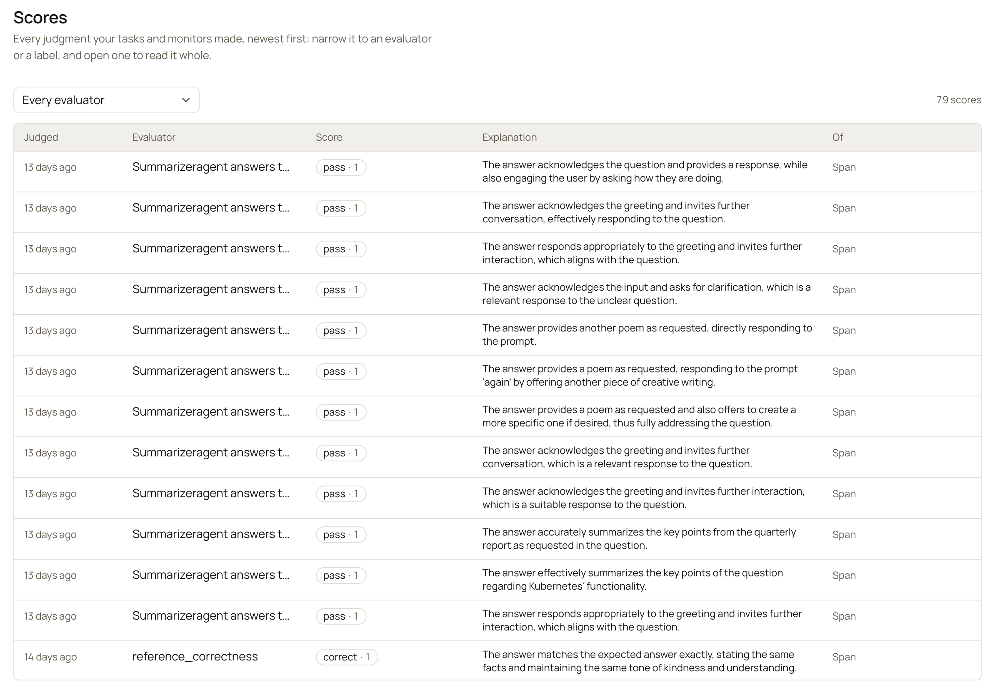
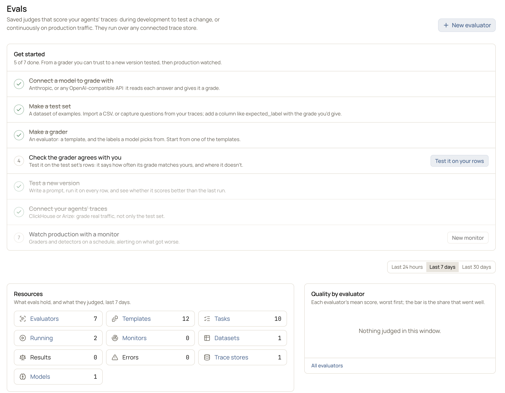

Every judgment an evaluator makes is a **score**, kept for as long as you keep the cell. Tasks, monitors and experiments
all write the same scores, so one page reads them all, and one set of figures sums them up.

## What a score holds

| Field | Meaning |
|---|---|
| **Evaluator** | Which judge, and which version of it |
| **Judged by** | The task, the monitor run or the experiment that asked |
| **Of** | The record: its trace, span or session, the agent that produced it, and when it happened |
| **Label**, **Score** | The verdict. A multi-question judge keeps one answer per question instead, each with its score |
| **Explanation** | The judge's reasoning, or what your code returned |
| **Tokens** | What judging the record cost, prompt and answer together. Zero for a code evaluator |
| **Error** | Why it could not be judged, when it could not: the judge named no label, the code threw, the model did not answer |
| **Judged** | When the verdict was made |

A score with an error has no label or score, and counts under **Errors** wherever errors are counted.

## Read the scores

**Monitor** > **Evals** > **Scores** lists every score, newest record first, 500 at a time with **Show more**, and
refreshes every 30 seconds. Filter by **evaluator**, then by **label** within it; the filters live in the page's
address, so a copied link opens the same view. Select a row for its panel: the full explanation, the record it judged
and its trace, the tokens, and who judged it.

{/* SCREENSHOT: evals-scores | crop | Scores filtered to "support-bot answer relevance" and the label irrelevant, with the Score panel open on the right. */}
<Frame caption="Scores, filtered, with one score open">
  
</Frame>

Three other places read the same scores:

- **A task's page**: its counts, a **Verdicts** bar of labels to filter by, and its results with their reasoning.
- **A monitor's report**: each run's findings, with the worst examples under each.
- **An experiment's page**: every row with its answer and each evaluator's verdict, and the scorecards.

## The overview

**Monitor** > **Evals** > **Overview** sums up a window, **Last 7 days** to start, from 1 to 90 days. It counts every
score in the window by when it was judged, from tasks, monitors and experiments alike.

{/* SCREENSHOT: evals-overview | full | Monitor > Evals > Overview, Window Last 7 days: Get started 5 of 7 done, Resources counts, Quality by evaluator, the four metrics and the top of Latest verdicts. */}
<Frame caption="The Evals overview, last 7 days">
  
</Frame>

| Figure | What it is | How it is computed |
|---|---|---|
| **Quality** | The share of records judged well | For each evaluator, its mean score if higher is better, or one minus it if lower is better; then the average across evaluators, weighted by how many records each judged. An evaluator with no direction is left out |
| **Quality by evaluator** | Each evaluator's mean, worst first | The raw mean score to two decimals, with "higher is better" or "lower is better", the count of results and errors, and a bar for the share judged well |
| **Error rate** | The share that could not be judged | Errors divided by all results, with a daily trend |
| **Judge tokens** | What judging spent | The sum of every score's tokens, with the average a result and a daily trend |
| **Latest verdicts** | The eight most recent scores across every task | Newest by the record's time |

**Quality by evaluator** is the figure to read first: a fall in one evaluator's mean is a change in the agent, a rise
in **Error rate** is a change in the judge or its connection.

## From a number to the answer behind it

Every figure leads back to records:

1. **Overview** > **Quality by evaluator** names the evaluator whose mean moved.
2. In **Scores**, filter to that evaluator and its bad label, read the explanations, and open a row.
3. The row names the trace; find it in [Observability](/monitor/observability) for the span's full input and output, with the rest of the run around it.
4. Disagree with the judge? The record is a new dataset row with your label: see
   [Align evaluators with your labels](/monitor/evals/align-with-your-labels). Agree? The record is a failure to fix,
   and the trace tells you where.

<Info>**Viewer** sees scores, labels, counts and figures. What the agent was asked and answered, and the judge's explanation, which may quote it, are shown only with the observability content permission, which **Operator** and above have.</Info>

## What judging costs

Each record a model judges is one model call: the record's text in, a label and a sentence out. That is the whole
cost, and OpenController counts it in tokens on every score. Nothing else is billed by the module.

| Lever | Where | Effect |
|---|---|---|
| **Sampling rate** | A task's configuration | Judges that share of matching records, chosen the same way every time: 10% of 50,000 spans a day is 5,000 calls, not 50,000 |
| **Token budget** | A task's **Advanced** settings, or **New budget** when resuming | The task judges a handful of records to learn the cost, then stops once judging has spent the budget. Resume with a larger budget, or none |
| **Records per check** | A monitor | Each run judges a sample of that size per evaluator, 100 to start |
| **The filter** | An evaluator's configuration | Judge the step that matters, `"name" = 'chat gpt-4o'`, not every span of the trace |
| **The record** | **Reads** | A span is cheaper than a whole run, which is cheaper than a conversation |
| **The model** | The judge's model | A small model with a clear definition is often as good as a large one. Check both against your labels before deciding |
| **Code evaluators** | The kind | No model, no tokens, no cost. Use them for every rule a program can check |
| **The LLM gateway** | The model connection | Judge through a virtual key of its own, so the judge's spend has a budget and shows in [Cost](/monitor/cost) |

Detectors in a monitor read no record with a model and cost nothing: errors, latency, token bloat, cost and loops come
from the spans' own metadata.

### Limits that protect the service

- Judging a person is waiting on (**Test**, **Try it**, Ask Ctrl) is held to a few calls at once and a number a minute
  per person; past it the console says to try again in a few seconds.
- A test judges five records, or 20 dataset rows, and keeps nothing.
- Each model call times out after two minutes. On Anthropic, a verdict is capped at 1,024 tokens.
- A task reads 100 records a batch and judges four at a time; a continuous task that has caught up waits a minute.
  `EVALS_WORKERS` runners share the tasks, two to start.

## What is kept, and for how long

Scores stay until the cell's database is cleared. Deleting a task, a monitor, a dataset or an experiment never removes
the scores it made; **Scores** and the overview keep counting them. A monitor's run reports go with the monitor, and a
dataset's experiments go with the dataset.

## Next steps

<CardGroup cols={2}>
  <Card title="Run tasks and read scores" icon="list-checks" href="/monitor/evals/tasks-scores">
    Sampling, budgets and a task's counters.
  </Card>
  <Card title="Watch production with monitors" icon="radar" href="/monitor/evals/monitors">
    Findings, thresholds and alerts.
  </Card>
</CardGroup>
