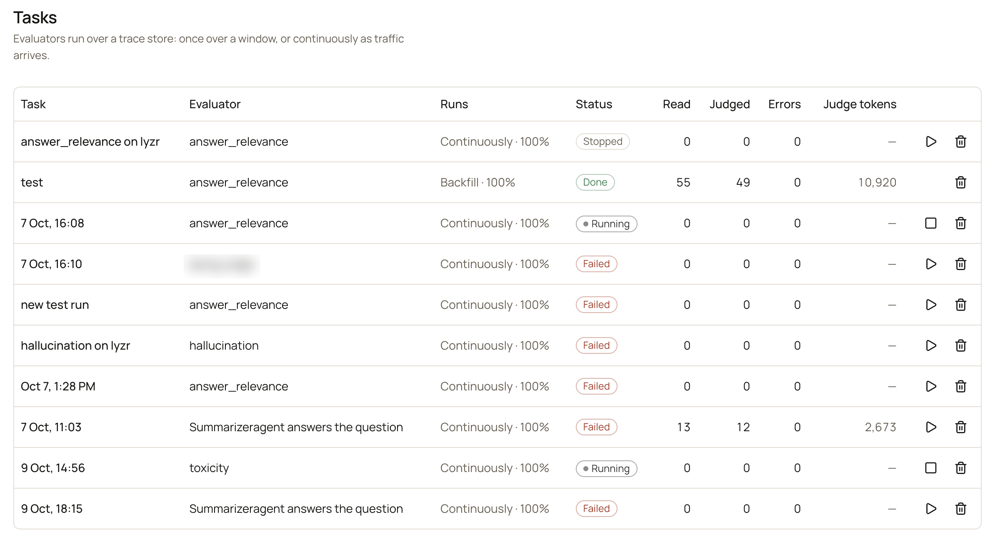
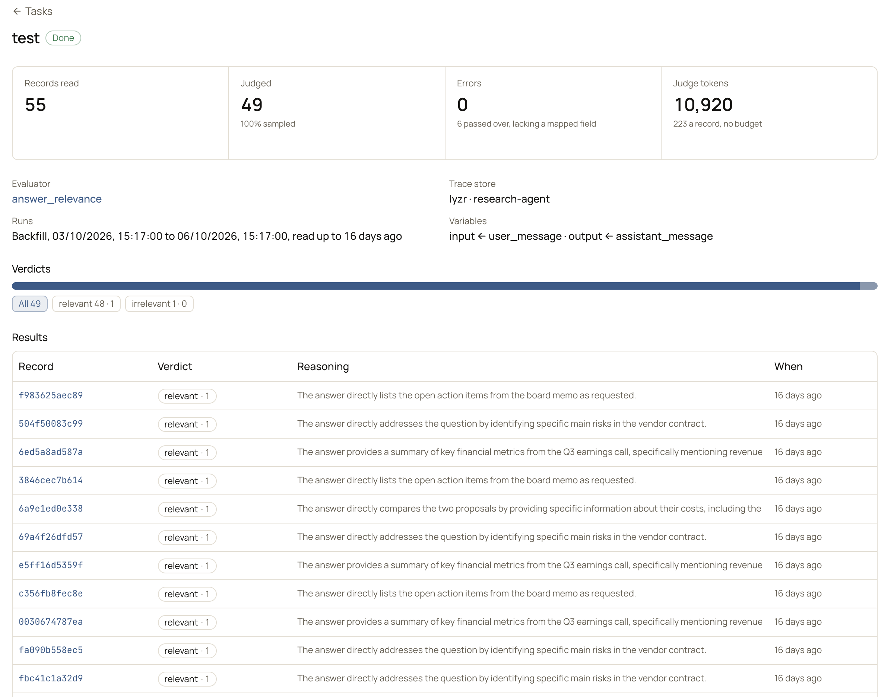
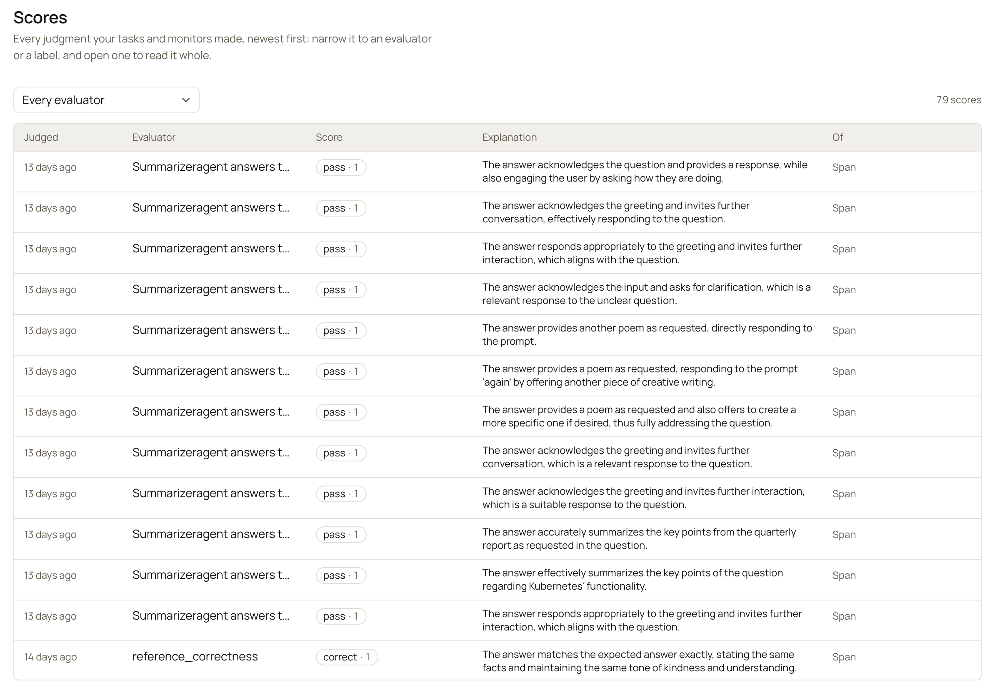

<Note>
**Before you start:** a saved evaluator that reads a trace store's project (see [Choose and build an evaluator](/monitor/evals/evaluators)), and the **Operator** role or above.
</Note>

A **task** is one evaluator pointed at one project of a trace store, with a filter, a mapping, a sampling rate and a
window. It is how an evaluator judges real traffic: a backfill over last week to see where you stand, or a continuous
task that judges every new record as it lands, for as long as you leave it running.

## Start a task

A task is made from an evaluator. Open it in **Evals** > **Evaluators**, set **Task configuration**, then select
**Create and run** (or **Save and run**).

| Setting | What it does | Range and start |
|---|---|---|
| **Name** | How the task is listed | Starts as the date and time; cleared, it becomes `<evaluator> on <trace store>` |
| **Sampling rate (%)** | The share of matching records the judge reads. Each one judged costs a model call | 1 to 100, starting at 100 |
| **Run continuously** | Judges each new record as it arrives, from now on | On to start |
| **One-time backfill** | Also judges the records already recorded, once, **From** a time back, and **To** a time when not continuous | From 24 hours ago to now, to start |
| **Token budget** (**Advanced**) | The task stops once judging has spent this many tokens | Empty is **No limit** |

Turn on either run mode, or both: continuous with a backfill judges last night and then keeps going.

**Sampling is steady.** Whether a record is in the sample is decided from its id, so the same record is always in or
always out, and two tasks at 20% on the same project judge the same fifth of the traffic. Lowering the rate later
drops records that were in; it never shuffles.

**Every variable must be mapped.** A task cannot be saved while a `{variable}` of the evaluator has no field; the editor
says which.

{/* SCREENSHOT: evals-tasks-list | crop | The Tasks table: one task running (Continuously · 20%), one backfill done (Backfill · 100%), one stopped, with counts and the Stop, Start and Delete buttons. */}
<Frame caption="Tasks and their status">
  
</Frame>

## A task's life

| Status | Meaning | Then |
|---|---|---|
| **Idle** | Saved, not started | **Start** |
| **Running** | A worker is reading and judging it | **Stop** |
| **Stopped** | Stopped by a person, or at its token budget | **Resume**; at the budget, with a **New budget, tokens** or none |
| **Done** | A backfill that has read everything in its window | Nothing more to run |
| **Failed** | Something it cannot get past, named on the task: a connection that fails, a code evaluator the service cannot run | Fix it, then **Resume** |

**Stop** lets the worker finish the batch it is on, then holds. **Resume** carries on from the task's cursor, the last
record it read, so nothing is judged twice and nothing is skipped. Deleting a task stops it and keeps every score it
made.

## How it runs

The evals service runs tasks on `EVALS_WORKERS` workers, two to start, each taking the task that has waited longest.
A worker reads 100 records at a time, from the cursor forward, and judges them four at once. It reads up to 30 seconds
short of now, so late spans still land in order. A continuous task that has caught up checks again a minute later.

A task holds a lease while a worker has it, so two workers never judge the same batch. If the service restarts, the
lease lapses and another worker picks the task up where the cursor stands.

## Follow a task

A running task's page refreshes every few seconds, and results appear as each batch finishes.

{/* SCREENSHOT: evals-task | crop | A running task's page: the four figures, the facts, the Verdicts bar with relevant and irrelevant filters, and the first rows of Results with their reasoning. */}
<Frame caption="A task's figures, verdicts and results">
  
</Frame>

| Figure | Counts |
|---|---|
| **Read** | Every record the task has read from the store, sampled or not |
| **Judged** | Records with a verdict |
| **Errors** | Records the judge failed on: it named no label, the code threw, the model gave no answer. Under it, how many were **passed over, lacking a mapped field**, which are not errors |
| **Judge tokens** | What judging has spent, **of a budget of** the budget, or the average **a record, no budget** |

The **Verdicts** bar shows each label's share and filters the results below it. Each result is the record, the label,
the score and the judge's reasoning.

## Token budgets

A budget is a ceiling, not an estimate. With one set, the task first judges four records to learn what a verdict
costs, then judges as many as the remaining budget pays for, and stops with **stopped at its budget: judging spent N
of M tokens** when it runs out. To go on, **Resume** with a larger **New budget, tokens**, or 0 for no limit. A code
evaluator spends no tokens and never meets a budget.

## Read every score

**Evals** > **Scores** lists every judgment your tasks, monitors and experiments made, newest first, with filters by
evaluator and label kept in the page's address. Every score keeps its reasoning, its record and what it cost. See
[Results and costs](/monitor/evals/results-and-costs) for the page, the overview's figures and how they are computed.

{/* SCREENSHOT: evals-scores | crop | Scores filtered to "support-bot answer relevance" and the label irrelevant, with the Score panel open on the right. */}
<Frame caption="Scores, filtered, with one score open">
  
</Frame>

## Who can use it

- **Viewer** reads tasks and scores, without the judge's explanation or the records' text.
- **Operator** also starts, stops and deletes tasks.

## Next steps

<CardGroup cols={2}>
  <Card title="Watch production with monitors" icon="radar" href="/monitor/evals/monitors">
    Compare each run with the ones before, and get alerts.
  </Card>
  <Card title="Results and costs" icon="coins" href="/monitor/evals/results-and-costs">
    The overview's figures, and the levers on spend.
  </Card>
</CardGroup>
