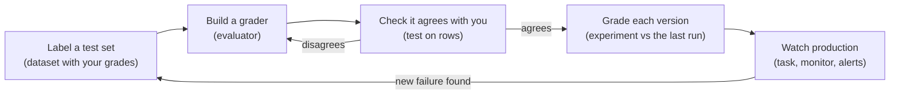

An agent can fail without an error. It answers politely, in time, with a made-up refund policy. Logs and traces show a
run that went well. An **eval** reads the answer itself and says whether it was any good.

## Why evaluate

Observability tells you an agent ran: how long it took, what it cost, whether a step failed. It cannot tell you whether
the answer was right, grounded, safe or on task, because nothing in a trace records that. Evals add the missing
column. Each record an agent produced gets a judgment, and the judgments add up to a quality you can watch, compare
between versions, and alert on.

Three questions evals answer that nothing else does:

- **Can I ship this change?** Grade the new version on the same test set as the last one, and count what got worse.
- **Is production still good?** Judge a sample of live traffic, and hear when a score drops below where it was.
- **Where does it fail?** Read the judge's reasoning on every record it marked down, with the record beside it.

## What an eval produces

Every judgment is a **score** with three parts:

| Part | What it is | Example |
|---|---|---|
| **Label** | One of the names the evaluator can answer with | `hallucinated` |
| **Score** | The number that label is worth, so judgments can be averaged and compared | `1` |
| **Explanation** | Why the judge chose it, in a sentence or two | "The answer cites a 30-day window the reference text does not mention." |

A code evaluator produces the same three parts, with the explanation written by your code. Each score keeps the record
it judged (the trace, span or session, and the agent), the evaluator, the task, monitor run or experiment that made it,
when the record happened, and the tokens judging it spent, so every number on a chart leads back to the answer behind
it.

## Three ways to judge

| | Model as a judge | Your own code | Your own labels |
|---|---|---|---|
| **Judged by** | A model, from a prompt and a set of labels | JavaScript you write | You, or your reviewers |
| **Good for** | Meaning: grounded, relevant, correct, safe, on task, resolved | Facts a program can check: a format, a value, a word, a length | The truth a grader is measured against |
| **Produces** | Label, score, reasoning | Label, score, explanation | An expected answer or grade on each row of a dataset |
| **Costs** | One model call a record | Nothing | Your time, once |
| **Same answer twice** | Nearly, at temperature 0 | Always | Always |

The three work together. Your labels on a test set say what good looks like. A model judge or a code evaluator learns
to agree with them, and once it does, it judges the thousands of records you could never read yourself. See
[Choose an evaluator](/monitor/evals/evaluators) for which kind fits which question, and
[Align evaluators with your labels](/monitor/evals/align-with-your-labels) for checking that a grader agrees with you.

## The loop

Evals pay off as a loop, not a one-off report. The **Get started** steps on the Evals overview walk it in order.

1. **Label a test set.** A dataset of real questions, what the agent had to go on, and the grade you would give.
   Capture rows from traces, or import them.
2. **Build a grader.** Start from a template, or write the judge yourself: a prompt and labels, several questions in
   one call, or code.
3. **Check it agrees with you.** Test the grader on the rows you labeled. Adjust until the agreement is high enough to
   trust.
4. **Grade each version.** An experiment answers every row with the new version and grades it, against the last run.
5. **Watch production.** A task judges a sample of live traffic as it arrives. A monitor runs checks and detectors on a
   schedule, compares each run with the ones before, and alerts on what got worse.

## The words

| Word | Meaning |
|---|---|
| **Evaluator** | A saved judge: a prompt and the labels or questions a model answers about a record, or your own code. |
| **Record** | What an evaluator reads at a time: **One step** (a span), a **Whole run** (a trace) or a **Conversation** (a session). |
| **Score** | One judgment: a label, a score and the judge's reasoning. |
| **Task** | One evaluator run over a trace store: once over a window, or continuously as traffic arrives. |
| **Monitor** | Several evaluators and detectors run on a schedule. Each run is compared with the runs before, with an alert on what got worse. |
| **Dataset** | A test set of examples, with the grades you would give them, kept in versions. |
| **Experiment** | A run that answers every row of a dataset and grades each answer, compared with an earlier run. |
| **Prompt** | Instructions that write an answer for each row of a dataset, saved in versions. |
| **Connection** | A trace store (ClickHouse or Arize) evaluators read from, or a model they judge with. |

## Where evals live

Everything is under **Monitor** > **Evals** in the console:

- **Overview**: the Get started steps, quality by evaluator, the error rate, judge tokens, and the latest verdicts.
- **Evaluators**, **Tasks**, **Scores**: the graders, their runs over trace stores, and every judgment.
- **Monitors**: the scheduled checks and their reports.
- **Datasets**, **Prompts**: the test sets, their experiments, and the prompts experiments answer with.
- **Connections**: the trace stores and models, for an **Admin**.

Evals run in their own service beside the platform, so judging never slows the API or the console. Scores also reach
the rest of OpenController: every experiment that evaluated an agent is on the agent's page in
[AI Inventory](/discover/asset-details), on its **Evaluations** tab.

## What it costs

Each record a model judges is one model call, and nothing more: the record's text in, a label and a sentence out.
**Judge tokens** on the overview is the running total. Three levers keep it where you want it: the **sampling rate**
of a task, a **token budget** that stops a task at a ceiling, and code evaluators, which cost nothing. See
[Results and costs](/monitor/evals/results-and-costs).

## Next steps

<CardGroup cols={2}>
  <Card title="Get started" icon="flask-conical" href="/monitor/evals/get-started">
    Turn the module on, connect a trace store and a model.
  </Card>
  <Card title="Choose an evaluator" icon="scale" href="/monitor/evals/evaluators">
    Which kind of judge fits which question.
  </Card>
  <Card title="Score answers with an evaluator" icon="play" href="/monitor/evals/guide-first-evaluator">
    The first evaluator, end to end.
  </Card>
  <Card title="Results and costs" icon="coins" href="/monitor/evals/results-and-costs">
    Read the scores, and keep judging spend in hand.
  </Card>
</CardGroup>
