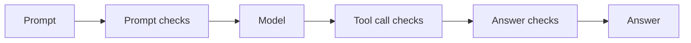

<Note>Needs the **Guardrails** module. See [Modules](/administer/modules).</Note>

A guardrail checks the text sent to a model and the text that comes back. It blocks or redacts what you do not want to pass.

{/* SCREENSHOT: gr-list | full | Runtime > Guardrails with 3–4 guardrails (e.g. "Customer support", "Internal copilot", "Text-to-SQL agent"), each row showing its line of dots, the summary sentence, the "LLM gateway · 1 rule" badge on at least one row, and the Use it anywhere and Try it buttons. Leave the console sidebar out. */}
<Frame caption="The Guardrails list">
  
</Frame>

## What you can do here

- [Learn what a guardrail is](#what-a-guardrail-is) and which checks it can hold.
- [See the path text takes](#the-path-text-takes): prompt, checks, model, checks, answer.
- [Read the Guardrails list](#the-guardrails-list) and act on each guardrail.
- [Use a guardrail in the LLM gateway](#in-the-llm-gateway) through a content rule.

## What a guardrail is

A guardrail is a set of checks. Each check looks for one thing, such as personal data, secrets or prompt injection. When a check finds it, the check blocks the text or changes it (redacts or masks what it found).

The guardrail engine in your OpenController keeps your guardrails and runs the checks. The text it reads does not leave it, unless you turn on a check that a cloud runs.

The checks come in groups, in the order the editor shows them:

| Group | Checks |
|---|---|
| **Data protection** | Personal data, Secrets |
| **Threat protection** | Prompt injection |
| **Content moderation** | Toxicity, Sexual content, Gibberish, Banned topics, Allowed topics |
| **Custom rules and format** | Keywords, Valid SQL, Valid OpenAPI |
| **Custom policies (OPA)** | Custom policies (OPA) |
| **Tool call rules (Cedar)** | Tool call rules (Cedar) |
| **Cloud provider guardrails** | AWS Bedrock guardrail, Azure content safety, Azure Prompt Shields, Azure personal data, Google Model Armor |

Every check, its settings and its defaults are in [Guardrail checks](/secure/guardrails/checks).

## The path text takes

A guardrail stands on both sides of the model. A prompt passes the prompt checks on its way in. The model's answer passes the answer checks on its way out. When a check decides tool calls, it stands after the model, before the tool runs.

- **Prompt checks.** Every check except the Cedar rules reads prompts.
- **Answer checks.** Only some checks also read answers: Secrets, Keywords, Valid SQL, Valid OpenAPI, Custom policies (OPA), AWS Bedrock guardrail, Azure content safety and Google Model Armor.
- **Tool call checks.** Tool call rules (Cedar), and OPA when you set it to also check tool calls.

The checks on one side run side by side. When one check blocks the text, the text stops there.

The guardrail editor draws this path at the top of the page, under **The path text takes**. Each check is a station on the line. A filled station is on. Select a station to open its settings.

{/* SCREENSHOT: gr-path | crop | The "The path text takes" strip at the top of the guardrail editor for "Customer support": Prompt, the Data, Threats and Content stations (Personal data, Secrets, Prompt injection, Toxicity on), Model, the answer-side stations, Answer. Crop to the strip only. */}
<Frame caption="The path text takes, in the guardrail editor">
  
</Frame>

## The Guardrails list

Go to **Runtime** > **Guardrails**. Each row is one guardrail:

- **Name.** Select it to open the guardrail.
- **LLM gateway** badge. The guardrail is in the LLM gateway. It also says how many content rules use it, for example **LLM gateway · 2 rules**.
- **Updated** time.
- **A line of dots.** The guardrail's path in miniature: a dot for each check, filled when it is on. The prompt checks come first, then the model, then any tool call checks that are on, then the answer checks.
- **A sentence** that says what the guardrail does, for example "Blocks prompt injection, toxic text and sexual content. Redacts emails, phone numbers, card numbers and US social security numbers. Masks secrets."

Each row has these controls:

| Control | What it does | Least role |
|---|---|---|
| **Use it anywhere** | Shows how an app, Claude Code or the LLM gateway uses this guardrail. See [Use a guardrail anywhere](/secure/guardrails/use-anywhere). | Viewer |
| **Try it** | Opens the guardrail, with **Try it** on the right. See [Try a guardrail](/secure/guardrails/try-it). | Operator |
| **More** (**…**) > **Duplicate** | Makes a copy named "*name* (copy)" and opens it. | Admin |
| **More** (**…**) > **Delete** | Deletes the guardrail. | Admin |

To make a guardrail, select **New guardrail**. See [Make and edit a guardrail](/secure/guardrails/create).

## In the LLM gateway

Every guardrail is put in the LLM gateway (Rekori) when you save it, or within 5 minutes if the gateway did not answer. There it is a guardrail provider named "*name* (OpenController)". It does nothing in the gateway until a content rule uses it.

To use it, an **Operator** makes a content rule in **LLM Gateway** > **Content Rules**:

1. Select **New guardrail**, and enter a **Name**.
2. Set **Matches by** to **A guardrail provider**.
3. Set **Provider** to the guardrail, "*name* (OpenController) · lyzr rai".
4. Set **Then** to **Block the request** or **Redact what matched**.
5. Under **Checks**, turn on **Prompts**, **Answers**, or both.
6. Set **Applies to**: **Every request**, one team, or one key.
7. Set **When the provider fails**: **Let the request through** or **Block the request**.
8. Select **Save**.

See [The gateway's own pages](/secure/routing-and-mcp) for the content rule form.

Each block or redaction a content rule makes is a violation. You see them on [Guardrail Violations](/secure/who-trips/violations).

While a content rule uses a guardrail, you cannot delete the guardrail. Remove or change the rule first.

## Who can use it

| Role | What they can do |
|---|---|
| **Viewer** | See guardrails, their checks, the OPA policies and the cloud provider connections. Open **Use it anywhere**. |
| **Operator** | Everything a Viewer can, plus try text on a guardrail (**Try it**), and call guardrails from apps and Claude Code. |
| **Admin** | Everything an Operator can, plus make, change, duplicate and delete guardrails, OPA policies and cloud provider connections. See [Guardrail Violations](/secure/who-trips/violations). |
| **Owner** | Everything an Admin can. |

See [Roles and permissions](/get-started/roles) for the permissions behind each role (`guardrails:read`, `guardrails:test`, `guardrails:write`, `guardrails:violations`).

## FAQ

<AccordionGroup>
  <Accordion title="Does a guardrail work without the LLM gateway?">
    Yes. An app can call a guardrail before and after its own model call, and Claude Code can call it through hooks. See [Use a guardrail anywhere](/secure/guardrails/use-anywhere).
  </Accordion>
  <Accordion title="Does a new guardrail block anything in the gateway right away?">
    No. Saving puts it in the gateway as a guardrail provider. It blocks or redacts only once a content rule uses it.
  </Accordion>
  <Accordion title="Where does the text go when a check runs?">
    The guardrail engine runs in your OpenController, and the text stays there. A cloud provider check (AWS Bedrock, Azure, Google Model Armor) sends the text to that cloud, in your own account.
  </Accordion>
  <Accordion title='The page says "The guardrail engine is not answering". What do I do?'>
    The engine may be starting, or down. Try again in a minute. If it persists, an admin can check the guardrail engine. The page names other states too: **No guardrail engine in this opencontroller**, **Guardrails need a secrets manager**, **opencontroller's guardrails account is disabled** and **The guardrail engine refused opencontroller's key**. Each says who can fix it. For the last two, an admin checks the service account `guardrails-platform` in **Settings** > **Service accounts**.
  </Accordion>
  <Accordion title="Where do I see if the guardrail engine is running?">
    Go to **Settings** > **Modules** > **Guardrails**. **Guardrail engine** says **Answering** and how many guardrails there are, or **Not answering**. Select **Check** to ask again.
  </Accordion>
</AccordionGroup>

## Next steps

<CardGroup cols={2}>
  <Card title="Create a guardrail" icon="shield-plus" href="/secure/guardrails/create">
    Start from a template and turn on the checks you need.
  </Card>
  <Card title="Guardrail checks" icon="list-checks" href="/secure/guardrails/checks">
    Every check, its settings and its defaults.
  </Card>
  <Card title="Try a guardrail on text" icon="flask-conical" href="/secure/guardrails/try-it">
    See what a guardrail does to a prompt or an answer.
  </Card>
  <Card title="Block prompt injection and personal data" icon="route" href="/secure/guardrails/block-prompt-injection">
    The end-to-end guide, from guardrail to content rule.
  </Card>
</CardGroup>
