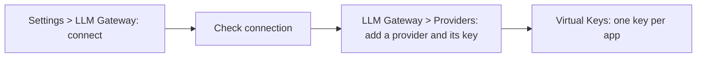

<Note>Needs the **LLM Gateway** module. See [Turn on modules](/administer/modules).</Note>

The LLM gateway (Rekori) runs as its own service. OpenController manages it through the gateway's management API. To set it up, you connect OpenController to the gateway, then add the model providers the gateway calls, each with its key. When you finish, the **LLM Gateway** pages show data, and you can give apps virtual keys.

<Note>
Before you start:
- You need the **Admin** role.
- The **LLM Gateway** module is on for your organization. If it is off, **LLM Gateway** is not listed in **Settings**, and its pages are hidden. Whoever runs your OpenController turns it on.
- The gateway is running and reachable from OpenController, for example at `https://gateway.example.com`.
- You have the gateway administrator's username and password, or a token it accepts. A local gateway with its sign-in off needs neither.
- You have an API key for each model provider your agents call, such as OpenAI or Anthropic.
</Note>

## Connect the gateway

<Steps>
  <Step title="Open the LLM Gateway settings">
    Go to **Settings** > **LLM Gateway**, under **Modules**. You get to the same place from **Connection** at the foot of the gateway menu, or from **Connect the gateway** on any gateway page that says **No LLM gateway connected**.
  </Step>
  <Step title="Choose the provider and address">
    - **Provider**: the kind of gateway. Choose **Rekori**.
    - **Base URL**: where OpenController reaches the gateway's management API, for example `https://gateway.example.com`, or `http://rekori:8080` beside a local stack.
  </Step>
  <Step title="Choose whether to show the gateway's console">
    Switch on **Show Rekori's own console inside opencontroller** to show Rekori's pages in place of OpenController's own. Rekori must allow OpenController to frame it.

    If the browser reaches Rekori's console at another address than the **Base URL** (for example, when the **Base URL** is an address inside the cluster), select **Its console is at another address** and type the **Console address**. Left empty, it is the **Base URL**. Select **Use the Base URL** to go back.
  </Step>
  <Step title="Choose how to sign in">
    In **Sign in**, choose how OpenController signs in to the gateway:

    | Option | When to use it | Fields |
    |---|---|---|
    | **No sign-in** | The gateway's own sign-in is off, as on a local gateway. | None. |
    | **Username and password** | Sign in as the gateway's administrator. | **Username**, **Password** |
    | **Token** | Sign in with a bearer token the gateway accepts. | **Token** |

    {/* SCREENSHOT: modules-gateway-form | crop | Settings > LLM Gateway, not yet connected: Provider Rekori, Base URL https://gateway.example.com, Show Rekori's own console inside opencontroller on, Sign in "Username and password", Username admin, Password masked. Crop to the section header and the form with its Save button. */}
    <Frame caption="Connecting the LLM gateway">
      
    </Frame>
    <Info>The password or token is kept in the secrets manager. It cannot be read back, and the browser never holds it. Later, leave the field empty to keep it, or type a new one to replace it. If you change the **Base URL** to another host, you must type the credential again.</Info>
  </Step>
  <Step title="Save">
    Select **Save**. A message says the endpoint is saved, and the **Connection** box appears below the form. It shows the **Base URL**, the sign-in, and **credential set** when a credential is stored.
  </Step>
  <Step title="Check the connection">
    In **Connection**, select **Check connection**. OpenController runs three checks:

    | Check | What it tests |
    |---|---|
    | **Reachable** | OpenController can reach the **Base URL**. |
    | **Version** | The gateway answers with its version. |
    | **Signed in** | The sign-in works. |

    Each check shows a green tick, or a red cross with the reason. When all pass, a message says the gateway "is reachable and signed in".
  </Step>
</Steps>

## Add a model provider

The gateway calls model providers with their own API keys. Your apps never hold those keys: they call the gateway with a virtual key instead.

<Steps>
  <Step title="Open Providers">
    Select **LLM Gateway** under **Runtime** in the sidebar, then **Providers** in the gateway menu. **Configured Providers** on the left lists the providers the gateway already calls.
  </Step>
  <Step title="Add the provider">
    Select **Add New Provider**, and pick the provider from the list, for example **Anthropic**, **AWS Bedrock** or **Gemini**. It joins **Configured Providers**, with no keys yet.
  </Step>
  <Step title="Add a key">
    With the provider selected, select **Add new key**, and fill in:

    | Field | What to enter |
    |---|---|
    | **Name** | A name for the key, for example `Production Key`. |
    | **Weight** | How calls are shared between this provider's keys: a higher weight gets more. Not used when adaptive load balancing is on. Default `1`. |
    | **API Key** | The provider's API key, or `env.NAME` for an environment variable the gateway reads. |
    | **Allowed Models** | The models this key may serve. **All Models** by default; left empty, the key serves none. |
    | **Blocked Models** | Models this key must never serve. A model in both lists is blocked. |
    | **Deployments** | Optional. Maps a model name in a request to the provider's own identifier, such as an Azure deployment name or a Bedrock inference profile. |

    Select **Save**.
  </Step>
</Steps>

## Check it worked

- **Settings** > **LLM Gateway** > **Connection**: **Check connection** shows three green ticks.
- **LLM Gateway** > **Providers**: each provider you call has a key, with **Enabled** on.
- **LLM Gateway** > **Overview**: the **Providers** list says **All N up**.

## Change or disconnect the gateway

To change the address or the sign-in, edit the form in **Settings** > **LLM Gateway** and select **Save**. Then select **Check connection** again.

To stop managing the gateway, select **Disconnect** in the **Disconnect** box and confirm. OpenController stops reaching it and deletes its credential from the secrets manager. The gateway keeps running and keeps everything set in it: providers, keys, virtual keys and rules.

## Next steps

<CardGroup cols={2}>
  <Card title="Give apps virtual keys" icon="key" href="/secure/virtual-keys">
    Give each agent its own key, with the models it may call, a budget and a rate limit.
  </Card>
  <Card title="Route models and connect MCP servers" icon="route" href="/secure/routing-and-mcp">
    Routing rules, MCP servers and content rules.
  </Card>
  <Card title="Guardrails" icon="shield-half" href="/secure/guardrails/list">
    Check prompts and answers that go through the gateway.
  </Card>
</CardGroup>
