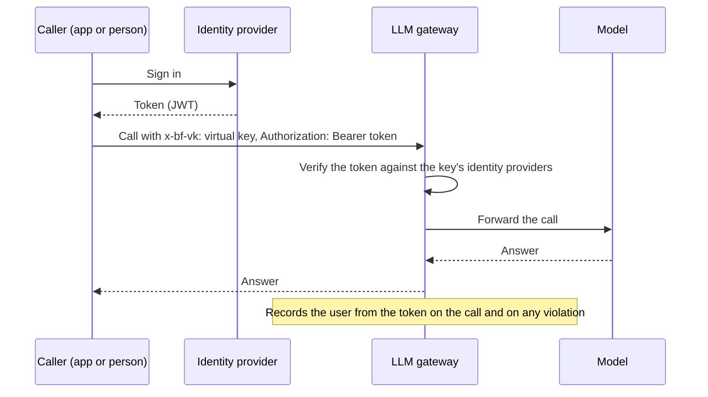

<Note>Needs the **LLM Gateway** module. See [Modules](/administer/modules).</Note>

An identity provider here is an OIDC issuer, such as Okta, Microsoft Entra ID, Auth0 or Keycloak, whose tokens the LLM gateway (Rekori) accepts from callers. When a virtual key requires it, each caller sends a token from that provider beside the key. The gateway then records which user made each call, and who tripped each guardrail. When you finish, the provider is in the gateway and a virtual key requires it.

<Info>This is sign-in for people who call the gateway. Sign-in to the OpenController console is set in [Single sign-on](/administer/sso). Sign-in to Rekori's own console is set in Rekori.</Info>

<Note>
**Before you start**
- You need the **Admin** role.
- The LLM gateway is connected, and it is Rekori. See [Connection](/secure/gateway-overview#connection).
- In your identity provider, an app or API whose tokens your callers get. You need its issuer address and the audience its tokens carry.
</Note>

## How caller sign-in works



A key that requires sign-in refuses a call with no token, or with a token that none of its identity providers verifies.

## Add an identity provider

<Steps>
  <Step title="Open Identity Providers">
    Go to **LLM Gateway**, open the **Routing** group in the gateway menu, and select **Identity Providers**. Select **New identity provider** at the top right.

    {/* SCREENSHOT: idp-list | crop | LLM Gateway > Routing > Identity Providers with two providers, Okta (issuer https://your-org.okta.com/oauth2/default, audience api://gateway) and Keycloak: columns Name, Issuer, Audiences, On, and the New identity provider button. Crop to the page content. */}
    <Frame caption="The Identity providers page">
      
    </Frame>
  </Step>
  <Step title="Fill in the form">
    Only **Name** and **Issuer** are required.

    | Field | What to enter |
    |---|---|
    | **Name** | A name for it, for example `okta`. It cannot change after you save. |
    | **Issuer** | The issuer address, exactly as it is in the tokens' `iss` claim, for example `https://your-org.okta.com/oauth2/default`. |
    | **JWKS URL** | Where the provider publishes its signing keys. Leave empty to find it from the issuer. |
    | **Audiences** | The audiences a token must carry, comma-separated, for example `api://gateway`. |
    | **Algorithms** | The signing algorithms to accept, for example `RS256`. |
    | **Clock leeway (seconds)** | How much clock difference to allow when checking a token's times. |
    | **Client ID** | The client ID of your app at the provider. |
    | **Scopes** | Scopes to ask for. |
    | **Subject claim** | The claim that names the caller. The gateway records its value as the user. Empty uses `sub`. |
    | **Scopes claim**, **Roles claim**, **Teams claim** | The claims that hold the caller's scopes, roles and teams, if your tokens use other names. |
    | **Enabled** | Leave on, so the gateway accepts its tokens. |

    Typical issuer addresses:

    | Provider | Issuer |
    |---|---|
    | Okta | `https://<your-org>.okta.com/oauth2/default` |
    | Microsoft Entra ID | `https://login.microsoftonline.com/<tenant-id>/v2.0` |
    | Auth0 | `https://<your-tenant>.auth0.com/` |
    | Keycloak | `https://<host>/realms/<realm>` |
  </Step>
  <Step title="Save">
    Select **Create**. The provider shows in the list with its switch under **On**.
  </Step>
  <Step title="Require it on a virtual key">
    Go to **LLM Gateway** > **Virtual Keys**, open the key's menu (**⋯**) and select **Edit**. Under **Callers sign in with**, switch on the new provider, then select **Save**. See [Virtual keys](/secure/virtual-keys#create-a-key).
  </Step>
  <Step title="Send the token with each call">
    Each caller sends the key and their token:

    ```bash
    curl https://gateway.example.com/v1/chat/completions \
      -H "x-bf-vk: $VIRTUAL_KEY" \
      -H "Authorization: Bearer $CALLER_TOKEN" \
      -H "Content-Type: application/json" \
      -d '{"model": "openai/gpt-4o-mini", "messages": [{"role": "user", "content": "Hello"}]}'
    ```
    {/* TODO verify: the gateway's public address and the OpenAI-compatible path and model naming callers use on Rekori */}
  </Step>
</Steps>

## Check it worked

- In the virtual key's form, the provider shows under **Callers sign in with** with its issuer next to it.
- A call with a valid token succeeds and shows in [Logs](/secure/logs).
- A call with no token is refused with `identity_token_required`.
- When a content rule blocks or redacts one of the calls, [Guardrail violations](/secure/who-trips/violations) shows it under the caller's user, not under **No user**.

## Edit, turn off or delete

- Switch **On** off in the list to stop accepting the provider's tokens. In the virtual key form it then shows **Disabled**.
- Open the row's menu (**⋯**) and select **Edit** to change it. **Name** cannot change.
- Select **Delete** to remove it. The gateway stops using it at once, and this cannot be undone. A key that still names it shows **Not in the gateway** next to it; switch it off there.

## Next steps

<CardGroup cols={2}>
  <Card title="See which users trip guardrails" icon="shield" href="/secure/who-trips/guide-violations-per-user">
    The end-to-end guide.
  </Card>
  <Card title="See guardrail violations" icon="triangle-alert" href="/secure/who-trips/violations">
    Read violations per user.
  </Card>
  <Card title="Give apps virtual keys" icon="key" href="/secure/virtual-keys">
    Require sign-in on a key.
  </Card>
  <Card title="Auth0" icon="fingerprint" href="/integrations/caller-identity/auth0">
    Set up the provider side.
  </Card>
</CardGroup>
