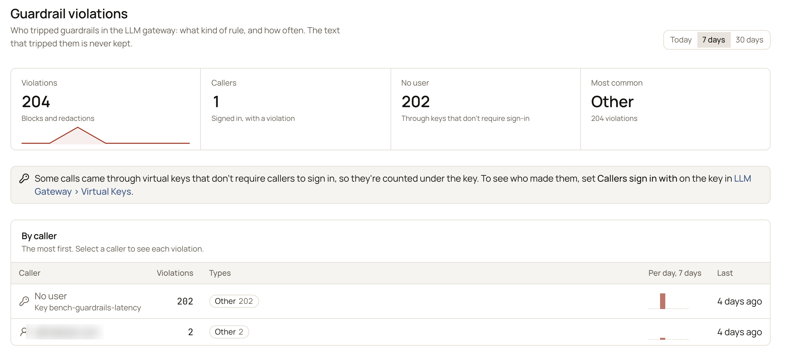
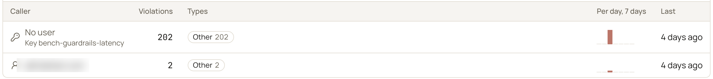
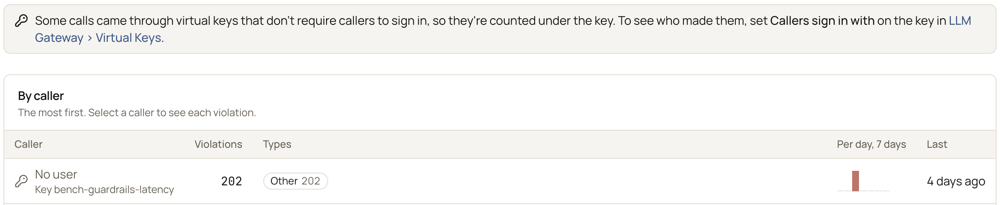

<Note>Needs the **Guardrails** module. What the LLM gateway's content rules did also needs a connected **LLM Gateway**. See [Modules](/administer/modules).</Note>

The text that tripped a guardrail is never kept.

{/* SCREENSHOT: viol-hero | full | Runtime > Guardrail Violations, window 7 days: the four figures (Violations with its trend, Callers, No user, Most common "Personal data"), the "No user" notice, and the By caller table with 5–6 rows (alice@example.com, bob@example.com, a "No user / Key support-bot" row), each with type badges and per-day bars. Leave the console sidebar out. */}
<Frame caption="Guardrail Violations, over 7 days">
  
</Frame>

## What you can do here

- [Choose the window](#choose-the-window): today, 7 days or 30 days.
- [Read the figures](#read-the-figures): how many violations, by how many callers, and the most common type.
- [Find repeat offenders](#find-repeat-offenders-by-caller) in the **By caller** table.
- [Open one caller's violations](#see-one-callers-violations), one by one, and [open the trace](#open-the-trace) of each call.
- [Make calls name their user](#make-calls-name-their-user), so you see who made each one.

A violation is one block or redaction, made in one of two places:

- **In the LLM gateway:** a content rule ran your guardrail, or the gateway's own PII rules, on a call. See [In the LLM gateway](/secure/guardrails/list#in-the-llm-gateway).
- **Through the guardrail API:** an app called `/v2/guardrails/inference` itself, or Claude Code's hooks called the guardrail, and the guardrail blocked or redacted. See [Violations from the guardrail API](#violations-from-the-guardrail-api).

The page shows both together, newest first.

## Choose the window

Go to **Runtime** > **Guardrail Violations**. At the top right, choose **Today**, **Last 7 days** or **Last 30 days**. The default is **Last 7 days**.

**Today** is the calendar day, from midnight to now. **Last 7 days** and **Last 30 days** are today and the 6 or 29 days before it, whole days. The picker has a time zone select, your local time or **UTC**: the days, and the per-day bars in **By caller**, follow the zone you choose. Because the window is whole days, the [time range picker](/monitor/observability#pick-the-time-range) offers only these presets here. The LLM gateway and the guardrail API each keep their record for 30 days.

## Read the figures

| Figure | What it counts |
|---|---|
| **Violations** | Blocks and redactions in the window, with a trend line per day. |
| **Callers** | People and service accounts with a violation: signed-in callers in the gateway, and the service accounts whose keys called the guardrail API. |
| **No user** | Violations through gateway keys that don't require sign-in. |
| **Most common** | The type with the most violations, and how many. "Nothing tripped" when there are none. |

When the window holds more violations than can be read at once, a notice says "More violations than can be read at once: the counts are of the newest" and how many.

## Find repeat offenders by caller

The **By caller** table lists each caller, the most violations first. Gateway calls that named no caller are grouped under the key they came by.

| Column | What it shows |
|---|---|
| **Caller** | The caller's user ID, from their sign-in token. Or **No user** and the key, for example "Key support-bot". Or a service account with **Guardrail API** beneath it, for calls its key made to the guardrail API. |
| **Violations** | How many in the window. |
| **Types** | A badge per type, with its count, the most first. |
| **Per day, *N* days** | A bar per day, oldest first. Every row uses one scale, so a caller with more stands taller. With **Today**, the column is named **Today**. |
| **Last** | When the last one was. Hover for the exact time. |

{/* SCREENSHOT: viol-row | crop | Two rows of the By caller table: alice@example.com with 14 violations, badges "Personal data 9", "Prompt injection 4", "Secrets 1" and tall per-day bars; and a quieter caller below for scale. Crop to the two rows and the column headers. */}
<Frame caption="Callers in the By caller table">
  
</Frame>

### Types

The type comes from the checks that fired. One violation can have several types, when several checks fired on the same text.

| Type | From |
|---|---|
| **Personal data** | Personal data, Azure personal data, and the gateway's own PII rules |
| **Secrets** | Secrets |
| **Prompt injection** | Prompt injection, Azure Prompt Shields |
| **Toxicity** | Toxicity, Azure content safety |
| **Sexual content** | Sexual content |
| **Gibberish** | Gibberish |
| **Topics** | Banned topics, Allowed topics |
| **Keywords** | Keywords |
| **Format** | Valid SQL, Valid OpenAPI |
| **Policy** | Custom policies (OPA), Tool call rules (Cedar), AWS Bedrock guardrail, Google Model Armor |
| **Other** | Any rule whose check is not one of these, such as a pattern or keyword rule made in the gateway |

See [Guardrail checks](/secure/guardrails/checks) for what each check looks for.

## Calls with no user

A call names its caller only when its virtual key requires callers to sign in. Calls through other keys are counted as **No user**, under their key. A call made without any virtual key shows as **No user** with **No virtual key**.

When there are such calls, a notice says so: "Some calls came through virtual keys that don't require callers to sign in, so they're counted under the key." It links to **LLM Gateway › Virtual Keys**.

{/* SCREENSHOT: viol-no-user | crop | The notice above By caller: "Some calls came through virtual keys that don't require callers to sign in…" with "Callers sign in with" and the LLM Gateway › Virtual Keys link, and below it one "No user / Key support-bot" row. Crop to the notice and the row. */}
<Frame caption="The No user notice, and a No user row">
  
</Frame>

## See one caller's violations

Select a row in **By caller**. A panel opens with the caller (or "No user, key *name*", or "*service account*, through the guardrail API"), and how many they had in the window. It lists their violations, newest first.

| Column | What it shows |
|---|---|
| **When** | How long ago. Hover for the exact time. |
| **Rule** | The content rule that fired. |
| **Did** | **Blocked the prompt**, **Blocked the answer**, **Redacted the prompt** or **Redacted the answer**. |
| **Types** | The types of what it found. |
| **Key** | The virtual key the call came by. |
| **Model** | The model called. |
| **Trace** | The start of the call's trace ID, linked to the trace. Shows when the **Observability** module is on. "—" when the call named no trace. |
| **Reason** | Why, in the rule's words. |

The panel shows 50 at a time. Under the list, it says which ones you see, for example "1–50 of 120". Select **Next** and **Previous** to move through them.

<Info>The text that tripped a guardrail is never kept. The gateway records who, which key and rule, the model, what the rule did and the types it found. Not the prompt or the answer.</Info>

## Open the trace

Select a trace ID in the **Trace** column to open the call in [Observability](/monitor/observability), where you read the whole run it was part of.

- **In the LLM gateway:** the violation carries the trace of the gateway's call.
- **Through the guardrail API:** the violation carries the trace the app sent in its `traceparent` header. See [Violations from the guardrail API](#violations-from-the-guardrail-api).

A violation with no trace shows "—".

## Violations from the guardrail API

An app can call the guardrail API itself (`/v2/guardrails/inference`), from its own gateway or code, and Claude Code's hooks call it too. See [Use guardrails in any app or Claude Code](/secure/guardrails/use-anywhere). When the guardrail blocks or redacts, the call is kept here, under the service account whose key made it. A call that passes is not kept.

Each is kept 30 days with:

- when, the guardrail, and the stage: the request (the prompt and tool results) or the response (the answer and its tool calls);
- the model the completion names;
- the checks that fired, and the reason;
- for a redaction, the kinds of value it masked, for example `Redacted PERSON, EMAIL`. Never the text.

To link a violation to its trace, the app sends the W3C `traceparent` header of the model call it checks:

```bash
traceparent: 00-<trace id>-<span id>-01
```

An app whose HTTP client is instrumented with OpenTelemetry sends it already. Only the app's own header is kept; without one there is no link.

The LLM gateway calls the guardrail engine directly, never through `/v2`, so a call is never counted twice.

## Make calls name their user

To see a person on each violation, the call must name its caller:

1. Add an identity provider to the LLM gateway, such as Okta, Entra ID, Auth0 or Keycloak. See [Identity providers](/secure/who-trips/caller-sign-in).
2. On the virtual key, turn on one or more providers under **Callers sign in with**. See [Virtual keys](/llm-gateway/access-and-spend/virtual-keys).
3. The app sends each caller's token from that provider beside the key: the key in the `x-bf-vk` header, the token as
   `Authorization: Bearer <token>`.

The gateway then records the token's subject as the caller: the claim set as **Subject claim** on the identity
provider, `sub` when it is empty. Leave **Callers sign in with** off for an agent that calls on its own.

The guide [See which users trip guardrails](/secure/who-trips/guide-violations-per-user) walks through it end to end.

## When there is nothing to show

| What you see | Why |
|---|---|
| **No LLM gateway connected** | The gateway's violations are read from the LLM gateway. Select **Connect one in Settings › LLM Gateway**. Without one, the page shows the guardrail API's violations alone. |
| **Not recorded** | The connected LLM gateway keeps no record of what its rules blocked. |
| **Not yours to see** | Who tripped guardrails names people, so it needs the `guardrails:violations` permission, an admin's by default. |
| "Nothing tripped a guardrail in this window." | No content rule or guardrail API call blocked or redacted anything. Try a longer window. |

## Who can use it

| Role | What they can do |
|---|---|
| **Viewer**, **Operator** | Cannot see this page. It is not in their sidebar. |
| **Admin** | See every caller's violations, and each one. |
| **Owner** | Same as **Admin**. |

The page needs the `guardrails:violations` permission. A custom role can hold it. See [Roles and permissions](/get-started/roles).

## FAQ

<AccordionGroup>
  <Accordion title="Can I see the prompt that was blocked?">
    No. The gateway does not keep the text, so OpenController cannot show it. The **Reason** column says why the rule fired.
  </Accordion>
  <Accordion title="Why are most of my violations under No user?">
    The calls came through virtual keys that don't require callers to sign in. Turn on **Callers sign in with** on those keys. See [Make calls name their user](#make-calls-name-their-user).
  </Accordion>
  <Accordion title="Why does one violation show two types?">
    Several checks fired on the same text, for example Personal data and Secrets. Each type is counted once for that violation.
  </Accordion>
  <Accordion title="Do tries in Try it show here?">
    No. **Try it** changes nothing and is not kept. Blocks and redactions by content rules in the LLM gateway show here, and so do the blocks and redactions of calls that apps and Claude Code's hooks make to the guardrail API.
  </Accordion>
  <Accordion title="How far back can I look?">
    Up to 30 days. The gateway and the guardrail API each keep their record for 30 days.
  </Accordion>
</AccordionGroup>

## Next steps

<CardGroup cols={2}>
  <Card title="See which users trip guardrails" icon="users" href="/secure/who-trips/guide-violations-per-user">
    Set up caller sign-in and read the results.
  </Card>
  <Card title="Give apps virtual keys" icon="key-round" href="/llm-gateway/access-and-spend/virtual-keys">
    Turn on Callers sign in with for a key.
  </Card>
  <Card title="Make callers sign in" icon="id-card" href="/secure/who-trips/caller-sign-in">
    Add the sign-in service callers get tokens from.
  </Card>
  <Card title="Guardrail checks" icon="list-checks" href="/secure/guardrails/checks">
    What each check looks for, and how to tune it.
  </Card>
</CardGroup>
