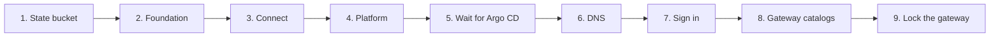

<Badge>Whoever runs your OpenController</Badge>

These steps follow the pack's `HANDBOOK.txt`. They are for private mode, the default; the lines that differ in public
mode are in [Choose your setup](/self-host/choose-your-setup).

<Note>
Before you start:
- Every item in [Requirements](/self-host/requirements#checklist) is done, Lyzr's registry access included.
- You unpacked the pack. The steps run from the pack folder, the one that holds `HANDBOOK.txt` and `infra/`.
- You run every command in bash, signed in to AWS as an administrator of the account.
</Note>

Replace each `<...>` with your value. `opencontroller` in the commands is `name` in File A and File C. If you changed
it, use yours.

| Placeholder | What it is | Example |
|---|---|---|
| `<account-id>` | Your AWS account's 12-digit ID | From `aws sts get-caller-identity` |
| `<region>` | The AWS region | `us-east-1` |
| `<state-bucket>` | The S3 bucket for OpenTofu's state | `example-opencontroller-state` |
| `<domain>` | The zone the addresses are in | `corp.example.com` |
| `<app-host>` | The application's address | `opencontroller.corp.example.com` |
| `<gateway-host>` | The LLM gateway console's address | `gateway.corp.example.com` |
| `<public-zone>` | The public zone that proves the certificate | `example.com` |
| `<your-network-cidr>` | The networks allowed to open the application | `10.0.0.0/8` |
| `<your-ip>` | The public IP of the machine you run from, if outside the VPC | `203.0.113.10` |
| `<org-id>` | A short ID for your organization: lowercase letters, digits and dashes | `example` |
| `<admin-email>` | The first administrator's email | `admin@example.com` |



## Install

<Steps>
  <Step title="Create the state bucket">
    OpenTofu keeps its record of what it built in an S3 bucket of yours. Versioning keeps old copies, for safety.

    ```bash
    aws s3 mb s3://<state-bucket> --region <region>
    aws s3api put-bucket-versioning --bucket <state-bucket> --versioning-configuration Status=Enabled
    ```
  </Step>
  <Step title="Build the foundation (about 20 minutes)">
    The foundation makes the network, your KMS key and the cluster. Make File A and File B from their examples:

    ```bash
    cd <pack folder>/infra/tofu/customer/aws/foundation
    cp terraform.tfvars.example terraform.tfvars
    cp backend.hcl.example backend.hcl
    ```

    Edit **File A** (`foundation/terraform.tfvars`). Every line you must change ends with `<-- CHANGE`.

    ```hcl
    account_id   = "<account-id>"
    region       = "<region>"
    private_zone = "<domain>"                 # e.g. "corp.example.com": a private zone is made for it
    tags         = { CostCenter = "1234" }    # optional

    network = {
      mode = "private"                        # "public" only for an application reachable from the internet
      ...
    }

    cluster = {
      public_access_cidrs = ["<your-ip>/32"]  # [] if you run from inside the VPC or over a VPN into it
      ...
    }
    ```

    Edit **File B** (`foundation/backend.hcl`):

    ```hcl
    bucket = "<state-bucket>"
    region = "<region>"
    ```

    Then build:

    ```bash
    tofu init -backend-config=backend.hcl
    tofu apply                               # read the plan, then type: yes
    ```

    If you set `public_zone` in File A, give its name servers to whoever runs your domain, as an `NS` record:

    ```bash
    tofu output public_zone_name_servers
    ```
  </Step>
  <Step title="Connect to the cluster">
    ```bash
    aws eks update-kubeconfig --region <region> --name opencontroller --kubeconfig ~/.kube/opencontroller
    export KUBECONFIG=~/.kube/opencontroller
    kubectl get nodes                        # every node: Ready
    ```

    Only if Lyzr asked for your cluster's ID (a license bound to your cluster): send Lyzr what this prints, and wait for
    your license file before the next step.

    ```bash
    kubectl get namespace kube-system -o jsonpath='{.metadata.uid}'; echo
    ```
  </Step>
  <Step title="Build the platform and install the application (about 30 minutes)">
    The platform makes the add-ons, the databases, every password, the HTTPS certificate and Argo CD. Argo CD then
    installs the application from Lyzr's registry.

    ```bash
    cd ..                                    # to infra/tofu/customer/aws
    cp terraform.tfvars.example terraform.tfvars
    cp backend.hcl.example backend.hcl
    cp <your license file> license.ocl
    ```

    Edit **File C** (`terraform.tfvars`):

    ```hcl
    account_id = "<account-id>"
    region     = "<region>"

    host         = "<app-host>"              # e.g. "opencontroller.corp.example.com"
    zone         = "<domain>"                # the same as private_zone in File A
    gateway_host = "<gateway-host>"          # e.g. "gateway.corp.example.com"

    alb_scheme        = "internal"           # "internet-facing" only with mode = "public" in File A
    alb_inbound_cidrs = ["<your-network-cidr>"]
    validation_zone   = "<public-zone>"      # the PUBLIC zone, e.g. "example.com"
    tags = { CostCenter = "1234" }           # the same as in File A

    organization = {
      id          = "<org-id>"
      admin_email = "<admin-email>"          # the first administrator
    }
    ```

    For a trial, which costs less: inside `document_database`, set `instance_class = "db.t4g.medium"` and
    `instances = 1`; inside `gateway_database`, set `high_availability = false`.

    The release is not in File C. It is in `release.auto.tfvars`, which the pack brings. Never edit that file.

    Edit **File D** (`backend.hcl`) with the same bucket and region as File B:

    ```hcl
    bucket = "<state-bucket>"
    region = "<region>"
    ```

    Then build:

    ```bash
    tofu init -backend-config=backend.hcl
    tofu apply                               # read the plan, then type: yes
    ```

    Before it installs anything, the plan checks that every image and the chart of the release are in Lyzr's
    registry and that your account may pull them. If not, it stops and names what is missing.
  </Step>
  <Step title="Wait for Argo CD to roll out the application (up to 10 minutes)">
    Repeat these until each shows what the comment says:

    ```bash
    kubectl -n argocd get application opencontroller    # SYNC STATUS Synced, HEALTH STATUS Healthy
    kubectl -n opencontroller get pods                  # every pod Running, READY 1/1 (ClickHouse 2/2)
    kubectl -n opencontroller get ingress               # ADDRESS filled: the load balancer exists
    ```

    The add-ons should be ready too:

    ```bash
    kubectl -n kube-system get deploy aws-load-balancer-controller cluster-autoscaler   # both READY
    kubectl -n keda get deploy                                                          # all READY
    ```
  </Step>
  <Step title="Check the address resolves">
    ExternalDNS writes `<app-host>` and `<gateway-host>` in your zone about a minute after the load balancer exists.

    - **Private mode:** the private zone resolves only inside the VPC. From your offices and VPNs, it resolves once
      your DNS forwards `<domain>` to the VPC. See [DNS in private mode](/self-host/choose-your-setup#dns-in-private-mode).
    - **Public mode:** the record is in your public zone and resolves everywhere.

    From a machine in your network:

    ```bash
    nslookup <app-host>
    ```

    If it does not resolve, see [Network and DNS](/self-host/troubleshooting#network-and-dns).
  </Step>
  <Step title="Sign in">
    Print the first administrator's password:

    ```bash
    aws secretsmanager get-secret-value --secret-id opencontroller/deploy/core \
      --query SecretString --output text | jq -r .DISCOVERY_ADMIN_PASSWORD
    ```

    Open `https://<app-host>` from inside your network. Sign in with `admin_email` from File C and that password, then
    change the password.

    <Warning>Run this in your own terminal only. The password gives full access to the console: never paste it into
    a ticket or a chat.</Warning>
  </Step>
  <Step title="Upload the LLM gateway's catalogs (private mode, once)">
    With no internet, the LLM gateway starts with empty catalogs: model prices, model settings and the MCP library.
    Upload them once.

    On any computer with internet access:

    ```bash
    curl -fsSL -o pricing.json          https://getbifrost.ai/datasheet
    curl -fsSL -o model-parameters.json https://getbifrost.ai/datasheet/model-parameters
    curl -fsSL -o mcp-library.json      https://getbifrost.ai/mcp-library
    ```

    Then, in the console, from a browser that also reaches `https://<gateway-host>`: each catalog has a
    **URL / Upload JSON** switch. Pick **Upload JSON**, choose the file, and select **Upload**.

    - **LLM Gateway** > **Routing** > **Model settings**: `pricing.json`, then `model-parameters.json`. The second is
      about 26 MB: wait until it says it is uploaded.
    - **LLM Gateway** > **Tools** > **MCP library** > **Settings**: `mcp-library.json`.

    Uploads are kept through restarts and upgrades. To refresh them, for example when new models come out, repeat
    this step.
  </Step>
  <Step title="Lock the LLM gateway, then add a model provider">
    Until you require one, calls to the gateway's models (`https://<gateway-host>/v1/chat/completions`) need no key.
    Before you add any provider's key:

    1. Go to **LLM Gateway** > **System** > **Security**.
    2. Turn on **Calls to models must bring a virtual key**.
    3. Keep **Let calls bring a provider's own key** off, and save.

    Then add a provider with your own key under **LLM Gateway** > **Providers**, and give each agent or team a
    virtual key of its own under **LLM Gateway** > **Virtual Keys**. Calls bring the virtual key in the `x-bf-vk`
    header.

    <Warning>Until **Calls to models must bring a virtual key** is on, anyone who reaches `<gateway-host>` can call
    your models with your provider keys.</Warning>

    The gateway's own console signs in as `admin`, with `BIFROST_ADMIN_PASSWORD`. Print it in your own terminal:

    ```bash
    kubectl -n opencontroller get secret opencontroller-rekori-env \
      -o jsonpath="{.data.BIFROST_ADMIN_PASSWORD}" | base64 -d; echo
    ```
  </Step>
</Steps>

## Check it worked

- `kubectl -n argocd get application opencontroller` shows **Synced** and **Healthy**.
- Every pod in `opencontroller` is **Running** and ready.
- `https://<app-host>` opens the sign-in page, with no certificate warning, from your network.
- **Settings** > **LLM Gateway** > **Connection** > **Check connection** shows three green ticks. The install
  connects the gateway for you.
- **LLM Gateway** > **System** > **Security** has **Calls to models must bring a virtual key** on.

If a step stops, see [Troubleshooting](/self-host/troubleshooting).

## Next steps

<CardGroup cols={2}>
  <Card title="Set up single sign-on" icon="log-in" href="/administer/sso">
    Connect your identity provider, map groups to roles, and later turn passwords off.
  </Card>
  <Card title="Connect your first account" icon="play" href="/get-started/quickstart">
    Connect a cloud or AI platform, run a scan, and read your inventory.
  </Card>
  <Card title="Set up alarms and backups" icon="heart-pulse" href="/self-host/monitor-and-recover">
    CloudWatch alarms, logs, and how to restore the databases.
  </Card>
  <Card title="Run and change your installation" icon="sliders-horizontal" href="/self-host/operate">
    Who can reach it, your own chart settings, secrets and the license.
  </Card>
</CardGroup>
