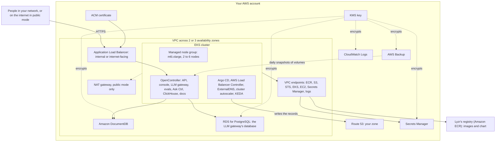
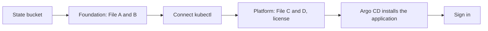

<Badge>Whoever runs your OpenController</Badge>

You can run OpenController in an AWS account of your own. Lyzr sends you a **pack**: OpenTofu code and the guides to
run it. You apply it in two parts:

- The **foundation** makes the network, your KMS key, the Kubernetes cluster (Amazon EKS) and the backup plan.
- The **platform** adds the cluster's add-ons, the databases, every password and key, the HTTPS certificate and
  Argo CD. Argo CD then installs the application.

You copy no image into your account. Your cluster pulls the images and the Helm chart from Lyzr's registry, over
AWS's own network, once Lyzr has let your account in.

<Info>The pack builds a new VPC and a new EKS cluster. It does not install into an existing VPC or an existing EKS
cluster: the platform part finds the cluster, its KMS key and its nodes' security group by the names the foundation
gives them.</Info>

## Architecture



| Part | What it is for | Made by |
|---|---|---|
| VPC | A private subnet in each zone for the nodes, the pods, the databases, the endpoints and an internal load balancer. Public mode adds a public subnet in each zone, an internet gateway and NAT. Every flow is logged to CloudWatch Logs. | Foundation |
| VPC endpoints | AWS's APIs from the private subnets: images, the pods' AWS identity, nodes and volumes, the load balancer, scaling, logs and Secrets Manager. Made in both modes. | Foundation |
| EKS cluster | Runs the application. Its API endpoint is private; it is public only to the addresses you list. Kubernetes Secrets are encrypted with your key. Pods get AWS identities through EKS Pod Identity. | Foundation |
| Node group | On-demand `m6i.xlarge` nodes (3 to start, 2 to 6 with the cluster autoscaler), Amazon Linux 2023, disks encrypted with your key. Pods cannot use the node's own AWS identity. | Foundation |
| KMS key | Your key, `alias/<name>`. It encrypts the databases, the cluster's Secrets, the volumes, Secrets Manager, the logs and the backups. Rotated every year. | Foundation |
| AWS Backup | A daily snapshot of the volumes on the cluster (ClickHouse's traces, OPA's policies), kept 35 days. | Foundation |
| Route 53 zones | In private mode, a private zone for your domain, seen only from the VPC. Optionally a public zone, if you have none. | Foundation |
| Cluster add-ons | The AWS Load Balancer Controller, KEDA, the cluster autoscaler, ExternalDNS, and an encrypted storage class for the platform's volumes. | Platform |
| Amazon DocumentDB | The application's main database (DocumentDB 8.0). Two instances by default, TLS 1.2 or newer, an audit log, daily backups with point-in-time restore. | Platform |
| RDS for PostgreSQL | The LLM gateway's settings and request logs. A standby in a second zone by default. | Platform |
| Secrets Manager | Every password and key, generated for you under `<name>/deploy/`. The application keeps the secrets you add in its **Settings** under `<name>/app/`. | Platform |
| ACM certificate | HTTPS for the application's address and the LLM gateway's address. | Platform |
| Argo CD | Installs the application's chart from Lyzr's registry and keeps the cluster as the settings say. | Platform |
| Application Load Balancer | Made by the AWS Load Balancer Controller from the application's Ingress. HTTPS on 443; HTTP is redirected. | The application |

`<name>` is `opencontroller`, unless you change `name` in File A and File C.

## What Lyzr provides

- **The pack.** One folder, `opencontroller/`, also sent as `opencontroller.tar.gz`. A new release comes as a new
  pack.
- **Your license file.** It ends in `.ocl`. A license can be bound to your cluster; then Lyzr asks for your cluster's ID
  during the install.
- **Access to Lyzr's registry** for your AWS account. You send Lyzr the account's ID before the install.

```text
opencontroller/
├── HANDBOOK.txt          the short install, upgrade and troubleshooting steps: start here
├── CLIENT-GUIDE.md       every option, explained
├── RUNBOOK.md            operations: monitoring, alarms, recovery, removal
├── CHANGELOG.md          what each pack changed, and what to do when you install it
├── CHANGES.txt           this pack's release, and the files changed since the previous pack
└── infra/
    ├── tofu/customer/aws/            the platform: you work here
    │   ├── foundation/               the network, the KMS key and the cluster
    │   ├── charts/application/       how Argo CD installs the application: do not change
    │   ├── overrides.yaml.example    your own chart settings, optional
    │   └── release.auto.tfvars       the release: Lyzr's file, never edited
    ├── tofu/modules/                 building blocks: do not change
    └── vault/                        building blocks: do not change
```

The images and the chart are not in the pack. `release.auto.tfvars` names them: the application's image tag, the LLM
gateway's, the documentation's and the chart's version. OpenTofu reads it after your settings, so the release is
always the pack's.

## What you own

You edit four files and add your license. Each file starts as a copy of the `.example` file beside it. No pack
contains or changes them.

| File | Path in the pack | What it holds |
|---|---|---|
| File A | `infra/tofu/customer/aws/foundation/terraform.tfvars` | Account, region, network mode, cluster size, private zone |
| File B | `infra/tofu/customer/aws/foundation/backend.hcl` | Your S3 state bucket and its region |
| File C | `infra/tofu/customer/aws/terraform.tfvars` | Addresses, load balancer, certificate, organization, database sizes, optional parts |
| File D | `infra/tofu/customer/aws/backend.hcl` | The same state bucket and region |
| License | `infra/tofu/customer/aws/license.ocl` | Your license file, copied to this name |
| Overrides | `infra/tofu/customer/aws/overrides.yaml` | Optional: your own chart settings |

Never edit a `.tf` file, `release.auto.tfvars`, or anything in `tofu/modules`, `vault` or `charts`.

OpenTofu keeps its state in an S3 bucket you create. Nothing else holds a record of what was built, so keep the
bucket for as long as the installation exists.

### Who does what

| Area | Owner |
|---|---|
| The AWS account, IAM, network, billing and service quotas | You |
| Installing, upgrading, monitoring, alarms, backups and restores, removal | You |
| First response to an incident | You |
| Application images, chart, releases and release notes | Lyzr |
| The license: issue, renew, revoke | Lyzr |
| Your account's access to Lyzr's registry | Lyzr |
| Application defects | Lyzr. See [What to send Lyzr](/self-host/troubleshooting#what-to-send-lyzr). |

## How an install runs



The whole install takes about an hour. See [Install on AWS](/self-host/install).

## Next steps

<CardGroup cols={2}>
  <Card title="Requirements" icon="list-checks" href="/self-host/requirements">
    Tools, AWS permissions, quotas, domain and certificate, and the IAM roles the stack makes.
  </Card>
  <Card title="Choose your setup" icon="network" href="/self-host/choose-your-setup">
    Private mode or public mode, and the other choices to make before you start.
  </Card>
  <Card title="Install on AWS" icon="download" href="/self-host/install">
    From an empty account to your first sign-in.
  </Card>
  <Card title="Troubleshooting" icon="life-buoy" href="/self-host/troubleshooting">
    Messages you may see, and what to do.
  </Card>
</CardGroup>
